# HadirMetrik — AI Employee Attendance & Workforce Management: System Architecture

**Document Version:** 1.1.0  
**Status:** Revised Baseline — onboarding karyawan oleh HR, undangan registrasi wajah (email/WhatsApp), autentikasi identifier ± password, dan skema bigint  
**Target Stack:** Flutter / Dart, Laravel REST API, PostgreSQL, Redis (optional queue/cache), Python FastAPI for face-recognition inference (subject to model and deployment decisions), Docker, Nginx  
**Architecture Style:** Polyrepo + Laravel Modular Monolith  
**Primary Interface:** Mobile application  
**Domain Strategy:** One root domain with a dedicated API subdomain; exact domain to be selected by the project team

---

> **Revisi 1.1.0 (2026-10-24):** Menambahkan desain registrasi karyawan yang bersifat **HR-only** (tanpa self-registration publik), pengiriman undangan registrasi wajah melalui **email dan/atau WhatsApp**, login dengan **email atau `employee_number` + password**, `employee_number` yang **dibuat otomatis** (format `HM-0251`), password sementara sistem yang ditampilkan sekali, master data divisi/shift/lokasi kerja, histori assignment dan kompensasi berbasis periode efektif, serta model undangan + delivery untuk audit. Semua PK diubah dari UUID ke **`bigint`**. Bagian yang direvisi pada dokumen ini ditulis dalam Bahasa Indonesia; bagian yang tidak disentuh tetap mempertahankan isi versi 1.0.0.
>
> ADR pendukung: `docs/adr/0002` … `0008` (lihat §15.1).

## 1. Executive Summary & Objective

HadirMetrik is an integrated employee activity and administration platform. It connects face-based attendance, task management, leave/permission/overtime requests, salary transparency, and HR monitoring within a common application ecosystem.

The architecture separates presentation clients from server-side business rules. Flutter provides the employee mobile experience. Laravel is the authoritative backend for identity, permissions, attendance rules, task workflows, administrative requests, compensation visibility, and audit history. A face-recognition service may run as a private Python service if the selected model and deployment approach require it.

The system is designed around the following principles:

- **Backend as Source of Truth:** Authorization, approval decisions, attendance policy, salary access, and final business state are enforced on the server.
- **Modular Monolith First:** Domain boundaries are explicit inside one Laravel application. Microservices are not introduced for ordinary business modules without a demonstrated need.
- **Offline-Tolerant Attendance:** The mobile client may queue eligible attendance events locally and synchronize them later. Offline events remain provisional until server validation completes.
- **Human Approval for Administrative Decisions:** Leave, permission, overtime, task review, and attendance corrections follow explicit workflow states and role checks.
- **Sensitive Data Protection:** Face templates, possible face images, salary records, location information, and employment records receive scoped access, retention policies, and audit logging.
- **Polyrepo with API Contract:** Mobile and backend can be developed independently while integrating through versioned REST endpoints documented using OpenAPI.
- **One Domain Family:** Public clients use HTTPS endpoints under the chosen domain. Internal AI and database services are not exposed directly to the public internet.

This document describes a proposed implementation baseline. Model selection, liveness policy, offline acceptance rules, dashboard platform, payroll source of truth, and production capacity must be confirmed before release.

---

## 2. System Context (C4 Level 1)

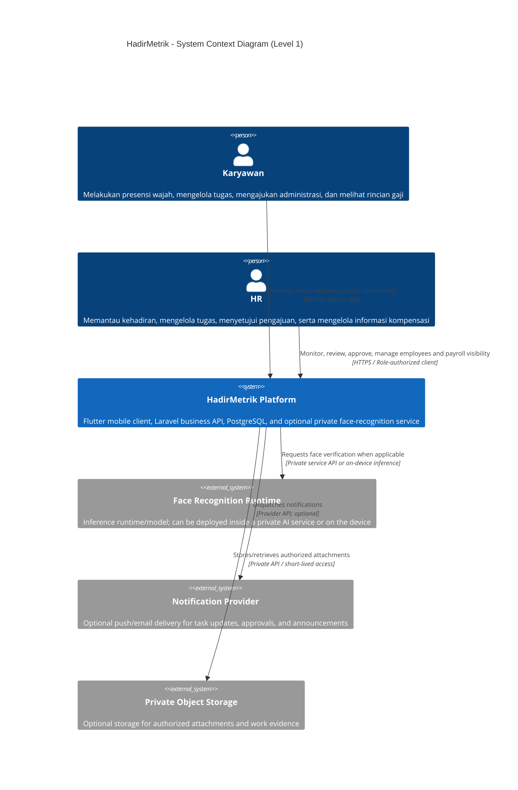

### 2.1 Actors and Scope

| Actor | Responsibilities |
|---|---|
| Karyawan | Check-in/check-out, view attendance history, receive and update tasks, submit work evidence, submit leave/permission/overtime requests, view permitted salary details. |
| HR | Monitor attendance and locations, review attendance anomalies, manage employee records, distribute and review tasks, approve administrative requests, manage salary statement availability and access. |
| System administrator (if required) | Manage system-level configuration and roles. This role should be separated from routine HR operations where possible. |

### 2.2 External Systems and Assumptions

- A push-notification provider is optional and not specified as a mandatory dependency.
- Private object storage is recommended if task attachments, request documents, or salary statement PDFs must be retained as files.
- The face-recognition runtime may be on-device, server-side, or hybrid. The final choice depends on accuracy, offline requirements, anti-spoofing needs, device capability, and privacy review.
- The provided application description does not define an external payroll or HRIS integration. Payroll data is therefore treated as backend-managed or imported until the source of truth is decided.

---

## 3. Component Architecture (C4 Level 2)

```mermaid
flowchart TB
    subgraph Clients["Presentation Layer"]
        Mobile["Flutter Mobile App (Dart)"]
        HRUI["HR Dashboard / HR Client (platform to be confirmed)"]
        LocalDB[("Local SQLite / Drift")]
    end

    subgraph Edge["Public Edge"]
        Nginx["Nginx / TLS / Reverse Proxy"]
        API["Laravel REST API (/api/v1)"]
    end

    subgraph Backend["Laravel Modular Monolith"]
        Identity["Identity & Access"]
        Employees["Employee Management"]
        Attendance["Attendance & Location Rules"]
        Tasks["Task Management"]
        Requests["Leave / Permission / Overtime"]
        Payroll["Salary Transparency"]
        FaceAdapter["Face Verification Adapter"]
        Sync["Offline Sync & Idempotency"]
        Reports["HR Dashboard & Reports"]
        Audit["Audit & Activity History"]
    end

    subgraph Infra["Persistence & Background Processing"]
        DB[("PostgreSQL")]
        Redis[("Redis — optional")]
        Worker["Laravel Queue Worker"]
        Scheduler["Laravel Scheduler"]
        Storage["Private Object Storage — optional"]
    end

    AI["Private Python FastAPI AI Service — optional"]
    Notify["Notification Provider — optional"]

    Mobile <--> LocalDB
    Mobile --> Nginx
    HRUI --> Nginx
    Nginx --> API
    API --> Identity
    API --> Employees
    API --> Attendance
    API --> Tasks
    API --> Requests
    API --> Payroll
    API --> FaceAdapter
    API --> Sync
    API --> Reports
    API --> Audit

    Identity <--> DB
    Employees <--> DB
    Attendance <--> DB
    Tasks <--> DB
    Requests <--> DB
    Payroll <--> DB
    Sync <--> DB
    Reports <--> DB
    Audit --> DB

    FaceAdapter --> AI
    API --> Redis
    Redis --> Worker
    Worker --> DB
    Scheduler --> DB
    Tasks --> Storage
    Requests --> Storage
    Payroll --> Storage
    Worker --> Notify
```

### 3.1 Architectural Boundaries

- **Flutter Mobile:** UI, client-side form validation, secure token storage, local cache, offline attendance outbox, and API integration.
- **HR Dashboard / HR Client:** Role-specific administrative views. The platform for this client remains a product decision; it can be a web application or an HR mode in the mobile app. Both should use the same Laravel API.
- **Laravel API:** Owns authorization, validation, business rules, workflow transitions, data persistence, and final decisions.
- **Face Verification Adapter:** A backend boundary that isolates the rest of the application from the selected AI provider, inference protocol, model version, and response format.
- **Python FastAPI AI Service:** Optional isolated inference service. It should be kept on a private network or protected with service-to-service authentication.
- **PostgreSQL:** Primary source of truth for operational records.
- **Redis / Queue Worker:** Optional at the earliest prototype stage; recommended for asynchronous notifications, file processing, and tasks that should not block API responses.
- **Object Storage:** Use private storage for attachments or salary statements if documents are stored as files. Do not expose buckets publicly.

### 3.2 Suggested Repository Layout

Use separate repositories for independent development and deployment:

```text
hadirmetrik-mobile/       # Flutter employee app
hadirmetrik-backend/      # Laravel modular monolith
hadirmetrik-ai-service/   # Python FastAPI; only if separately needed
hadirmetrik-admin/        # HR web dashboard; only if implemented as a separate web client
```

The API contract is the integration boundary between repositories. A shared OpenAPI document can be stored in the backend repository and published or copied to a versioned API-contract location. Repository separation does not mean that the apps cannot share a domain.

### 3.3 Suggested Laravel Domain Modules

```text
app/
├── Modules/
│   ├── Identity/
│   ├── Employees/
│   ├── Attendance/
│   ├── FaceVerification/
│   ├── Tasks/
│   ├── AdministrativeRequests/
│   ├── Payroll/
│   ├── Notifications/
│   ├── Reports/
│   ├── Sync/
│   └── Audit/
├── Http/
│   ├── Controllers/
│   ├── Middleware/
│   └── Requests/
├── Jobs/
├── Policies/
└── Providers/
```

This is a suggested domain organization, not a Laravel framework requirement. Standard Laravel folders can also be retained if service classes, policies, transactions, and module boundaries are consistently enforced. The modules remain part of one Laravel application and one primary database unless future evidence justifies extraction.

### 3.4 Suggested Flutter Feature Layout

```text
lib/
├── core/
│   ├── auth/
│   ├── networking/
│   ├── database/
│   ├── sync/
│   └── security/
├── features/
│   ├── attendance/
│   ├── face_verification/
│   ├── tasks/
│   ├── administrative_requests/
│   ├── salary/
│   └── profile/
└── main.dart
```

---

## 4. End-to-End Sequence Flows

### 4.1 Face Attendance — Online

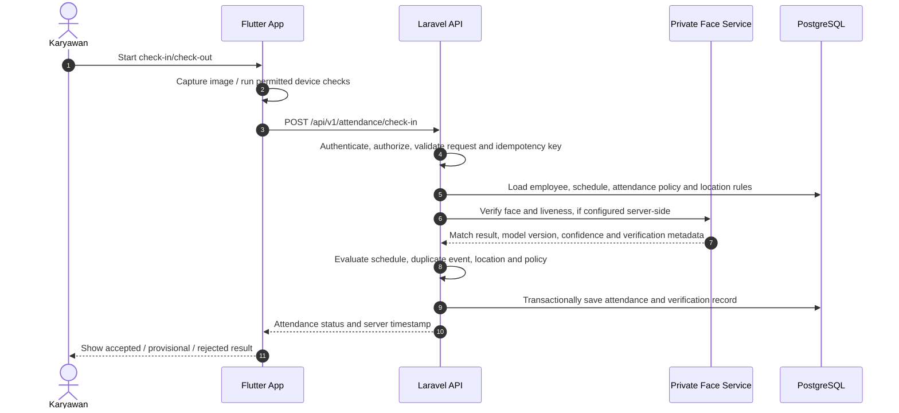

**Important:** A similarity score alone does not prove liveness or physical presence. The exact checks depend on the evaluated model, liveness approach, camera capture flow, and policy.

### 4.2 Offline Attendance and Synchronization

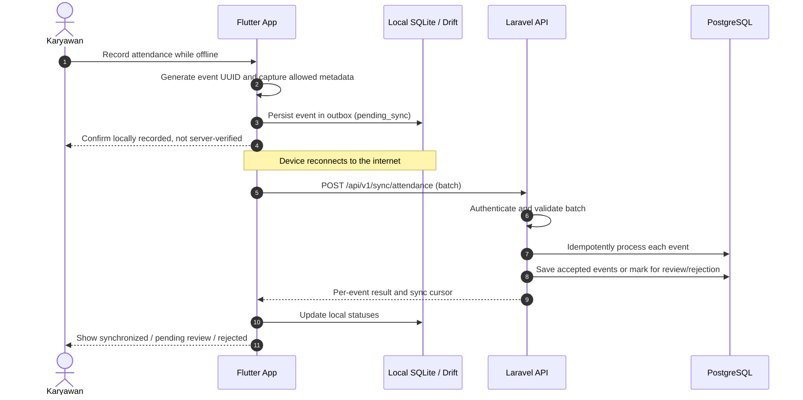

Offline events are provisional until the server completes validation. Device time, GPS, and local AI output can be manipulated; they must not be treated as conclusive evidence by themselves.

### 4.3 Task Lifecycle

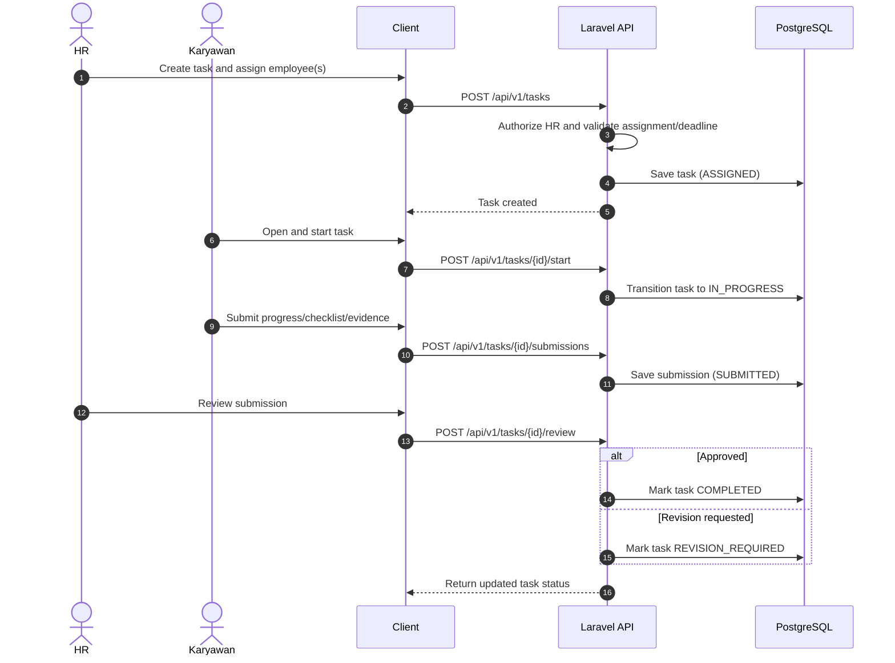

### 4.4 Leave / Permission / Overtime Request

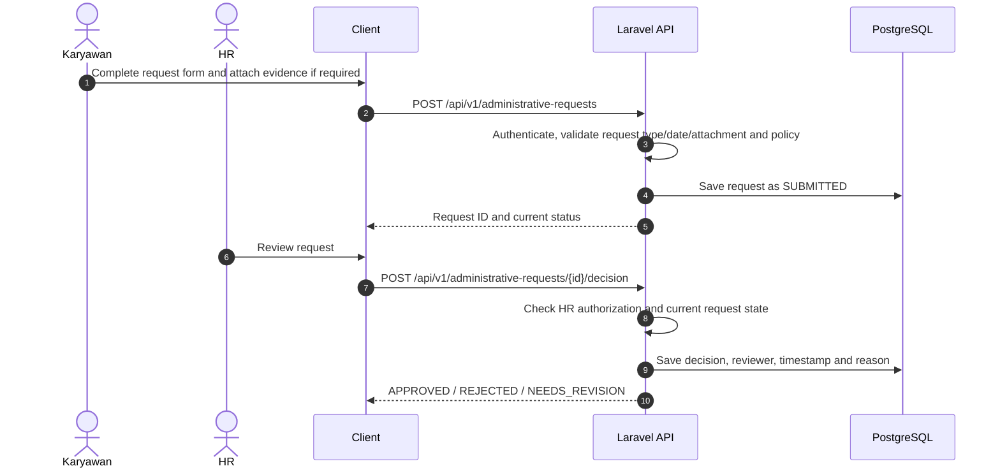

### 4.5 Salary Transparency

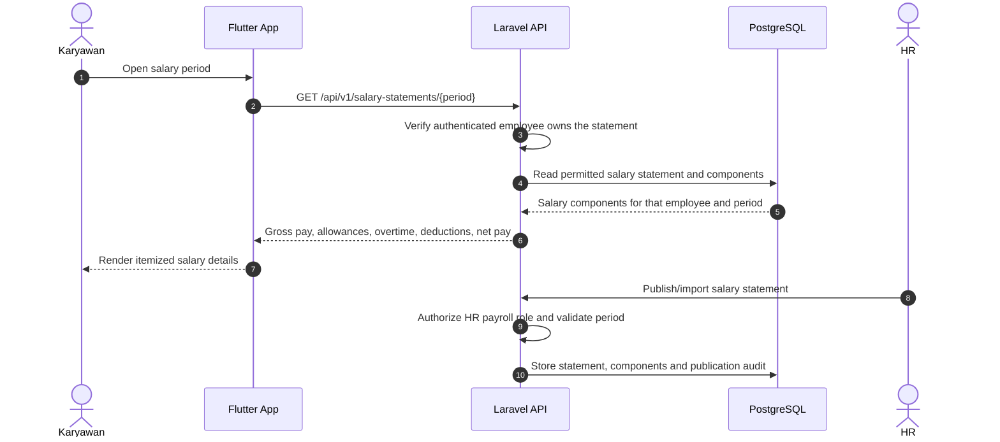

Salary values must be protected by object-level authorization. A client must never be able to retrieve another employee's salary simply by changing an ID or period parameter.

### 4.6 Registrasi Karyawan oleh HR (Create Employee + Undangan) — *baru di v1.1*

> Flow ini **menggantikan** flow register lama (`POST /register` dengan `invitation_code`).
> Registrasi bersifat **HR-only**; tidak ada self-registration publik. Legacy endpoint
> `/register` akan ditandai *deprecated* dan dihapus setelah repo mobile berpindah.

```mermaid
sequenceDiagram
    autonumber
    actor HR as HR
    participant UI as Klien HR
    participant API as Laravel API
    participant DB as PostgreSQL
    participant Q as Queue Worker / Gateway email & WhatsApp

    HR->>UI: Buka form “Tambah Karyawan”
    HR->>UI: Isi nama, email, nomor WhatsApp, divisi, jabatan, atasan langsung, tanggal mulai, shift, lokasi kerja, kompensasi, toggle kirim undangan
    UI->>API: POST /api/v1/hr/employees
    API->>API: Autentikasi + cek role HR (role ditetapkan backend, tidak dibaca dari payload)
    API->>API: Validasi: divisi/shift/lokasi aktif, manager aktif & tanpa cycle, saluran undangan (WhatsApp wajib bila dipilih), rentang expiry 1–14 hari
    API->>API: Generate `employee_number` berikutnya (format `HM-0251`) dan password sementara acak
    API->>DB: BEGIN TRANSACTION
    API->>DB: INSERT users (email lowercase, password hash sementara, role=employee, status=active, must_change_password=true)
    API->>DB: INSERT employees (user_id, employee_number, manager_id, division_id, employment_start, employment_status)
    API->>DB: INSERT employee_compensations (paket aktif, effective_from = employment_start)
    API->>DB: INSERT employee_shift_assignments + employee_work_location_assignments (effective_from = employment_start)
    alt send_invitation = true
        API->>DB: INSERT employee_invitations (token_hash SHA-256 + pepper, expires_at = created_at + 3 hari default)
    else send_invitation = false
        Note over API,DB: Employee tetap dibuat tanpa undangan; HR bisa mengirim undangan belakangan
    end
    API->>DB: INSERT audit_logs (employee.created, compensation.created, assignment.created, invitation.created)
    API->>DB: COMMIT
    API->>Q: Dispatch job pengiriman undangan (per channel, idempotent)
    API-->>UI: Data employee + employee_number + status undangan + status delivery per channel + initial_password (ditampilkan sekali)
    Q-->>DB: INSERT invitation_deliveries; UPDATE sent_at / last_sent_at
    Note over HR,UI: HR menyampaikan initial_password lewat kanal terpisah (bukan email/WhatsApp undangan). Password tidak pernah disimpan plaintext dan tidak masuk log.
```

**Catatan transaksi:** seluruh insert di atas harus atomik. Jika penyisipan salah satu bagian gagal (misal `EMAIL_TAKEN`), transaksi rollback dan tidak ada user/employee/undangan yang tertinggal. Job pengiriman baru dispatch setelah commit (idempotency diatur §8.2).

### 4.7 Pengiriman Undangan dan Callback Delivery

```mermaid
sequenceDiagram
    autonumber
    participant API as Laravel API
    participant Q as Queue Worker
    participant GW as Email / WhatsApp Gateway
    participant DB as PostgreSQL

    Q->>GW: Kirim link registrasi wajah + instruksi
    GW-->>Q: ACK (accepted) + provider_message_id
    Q->>DB: UPDATE invitation_deliveries SET status='sent', sent_at, provider_message_id
    API->>DB: UPDATE employee_invitations SET status='sent', sent_at, last_sent_at (idempotent)
    GW-->>API: Webhook delivery callback
    API->>API: Verifikasi signature webhook, dedupe provider_message_id
    API->>DB: UPDATE invitation_deliveries SET status='delivered'/'failed', delivered_at/failed_at, error_code
    Note over API,DB: Kegagalan satu channel tidak mengubah status employee/akun; retry membuat delivery baru dengan attempt berikutnya. Token/password tidak pernah muncul di log webhook.
```

### 4.8 Login, Wajib Ganti Password, Accept Undangan, Enrollment Wajah

```mermaid
sequenceDiagram
    autonumber
    actor Employee as Karyawan
    participant App as Flutter App
    participant API as Laravel API
    participant DB as PostgreSQL
    participant AI as Face Service

    Employee->>App: Login dengan identifier (email ATAU employee_number) + password
    App->>API: POST /api/v1/auth/login
    API->>DB: Cari user via email ATAU employees.employee_number; verifikasi hash; cek status
    alt user suspended
        API-->>App: 403 ACCOUNT_SUSPENDED (tanpa membocorkan detail lain)
    else kredensial salah
        API-->>App: 401 INVALID_CREDENTIALS (pesan generik) + security_events login.failed
    end
    API->>DB: security_events login.succeeded; UPDATE last_login_at
    API-->>App: Token + must_change_password=true
    Note over App,API: Jika must_change_password, semua endpoint lain selain /auth/logout dan /auth/me hanya mengizinkan akses perubahan password
    Employee->>App: Ganti password lewat form
    App->>API: POST /api/v1/auth/change-password
    API->>DB: UPDATE users SET password=hash_baru, must_change_password=false; security_events password.changed
    API-->>App: Sesi penuh aktif

    Employee->>App: Klik link registrasi wajah dari email/WhatsApp
    App->>API: POST /api/v1/invitations/{token}/accept (dengan token sesi login)
    API->>DB: Validasi: hash token cocok (constant-time), belum expired, belum revoked, belum accepted, employee_id undangan = employee milik user login
    API-->>App: Reservation undangan valid untuk enrollment

    Employee->>App: Kamera mengambil citra wajah + liveness check
    App->>API: POST /api/v1/face/enrollments (invitation token)
    API->>DB: INSERT face_templates (status=pending, provider, model_version)
    API->>AI: Kirim citra terenkripsi via FaceVerificationProvider
    AI-->>API: template_reference, quality_score, model_version
    alt Enrollment sukses
        API->>DB: UPDATE face_templates set status='active', enrolled_at; partial-unique aktif per employee
        API->>DB: UPDATE employee_invitations SET status='accepted', accepted_at; UPDATE employees SET face_registered_at
        API->>DB: INSERT audit_logs (face.enrolled, invitation.accepted); security_events face.enrollment.succeeded
    else Enrollment gagal (kualitas rendah / gagal liveness)
        API->>DB: face_templates status='failed'; invitation tetap pending (bisa dicoba ulang sampai expiry)
        API->>DB: security_events face.enrollment.failed
    end
    API-->>App: Status enrollment / instruksi coba lagi
```

### 4.9 Resend dan Revoke Undangan — *baru di v1.1*

```mermaid
sequenceDiagram
    autonumber
    actor HR as HR
    participant UI as Klien HR
    participant API as Laravel API
    participant DB as PostgreSQL
    participant Q as Queue Worker

    HR->>UI: Pilih employee → Resend undangan
    UI->>API: POST /api/v1/hr/employees/{id}/invitations
    API->>API: Autorisasi HR; hanya undangan pending/sent yang boleh di-resend
    API->>DB: TRANSACTION: revoke undangan lama (token lama tidak berlaku) → buat undangan baru (token_hash baru, expires_at dihitung ulang)
    API->>DB: audit_logs invitation.resent
    API->>Q: Job kirim per channel yang dipilih
    API-->>UI: Undangan baru + status delivery per channel

    HR->>UI: Pilih employee → Revoke undangan
    UI->>API: DELETE /api/v1/hr/invitations/{id}
    API->>DB: UPDATE employee_invitations SET status='revoked', revoked_at (guard: tidak boleh revoked dua kali)
    API->>DB: audit_logs invitation.revoked
```

### 4.10 Scheduler Expiry Undangan

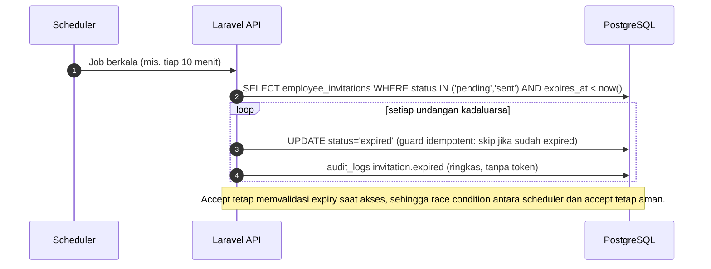

### 4.11 Terminasi / Suspensi Karyawan dan Pencabutan Akses

```mermaid
sequenceDiagram
    autonumber
    actor HR as HR
    participant UI as Klien HR
    participant API as Laravel API
    participant DB as PostgreSQL
    participant AI as Face Service

    HR->>UI: Ubah status karyawan → terminated / suspended
    UI->>API: POST /api/v1/hr/employees/{id}/employment-status (endpoint lanjutan M2)
    API->>DB: UPDATE employees SET employment_status; UPDATE users SET status='suspended'
    API->>DB: Revoke undangan aktif (status='revoked', revoked_at)
    API->>DB: Revoke face_template aktif (status='revoked', revoked_at) + hapus template di face service sesuai retensi
    API->>DB: Cabut semua token akses (personal access tokens)
    API->>DB: audit_logs employee.employment_status_changed (before/after, reason)
    API-->>UI: Konfirmasi perubahan status
    Note over API,DB: Terminasi bersifat terminal di level HR; reaktivasi hanya lewat admin + audit (§5.10).
```

---

## 5. Domain State Machines

### 5.1 Attendance Event State

```text
[CAPTURED_LOCAL]
      |
      | queued for synchronization
      v
[PENDING_SYNC] --> [SYNCING]
                      |
          +-----------+------------+
          |           |            |
          v           v            v
      [ACCEPTED] [PENDING_REVIEW] [REJECTED]
          ^           | 
          |           v
          +------[REVIEW_ACCEPTED]
                      |
                      +----------> [REVIEW_REJECTED]

[SYNCING] --transient network/server failure--> [SYNC_FAILED]
[SYNC_FAILED] --retry--> [PENDING_SYNC]
```

Suggested rules:

- `CAPTURED_LOCAL` and `PENDING_SYNC` are local states, not server-accepted attendance states.
- The server decides `ACCEPTED`, `PENDING_REVIEW`, or `REJECTED`.
- Retry must reuse the same `event_id` / idempotency key.
- Review actions must be recorded with actor, timestamp, decision, and reason.
- Do not silently change an accepted record; use correction records and audit history.

### 5.2 Task State

```text
[DRAFT] --> [ASSIGNED] --> [IN_PROGRESS] --> [SUBMITTED]
                 ^                                |
                 |                                v
                 |                         [UNDER_REVIEW]
                 |                           /        \
                 |                      approve      revision
                 |                          |            |
                 |                          v            v
                 +-------------------- [COMPLETED] [REVISION_REQUIRED]
                                                       |
                                                       v
                                                  [IN_PROGRESS]
```

Suggested terminal or exceptional states such as `CANCELLED` may be added when the task policy is defined. State transitions must be checked server-side rather than accepted directly from the client.

### 5.3 Administrative Request State

Applies to cuti, izin, and lembur requests, with request-specific validation rules:

```text
[DRAFT] --> [SUBMITTED] --> [UNDER_REVIEW]
                                |
               +----------------+----------------+
               |                |                |
               v                v                v
          [APPROVED]        [REJECTED]     [NEEDS_REVISION]
                                                   |
                                                   v
                                               [SUBMITTED]
```

The API should prevent decisions from being applied twice and should define whether an approved request can be cancelled or amended.

### 5.4 Salary Statement State

```text
[DRAFT] --> [REVIEWED] --> [PUBLISHED] --> [SUPERSEDED]
   |
   +--------------------> [CANCELLED]
```

This is a proposed workflow. If the system imports finalized payroll from another source, the statement may enter as `REVIEWED` or `PUBLISHED` based on the integration contract.

### 5.5 Permitted Transition Rules

| Entity | Transition | Authorized actor | Server-side guard |
|---|---|---|---|
| Attendance | Pending review → accepted/rejected | HR with attendance-review permission | Event is reviewable; decision and reason are recorded. |
| Task | Draft → assigned | HR/task manager | Actor can assign task and assignees are active employees. |
| Task | Submitted → completed/revision required | Task reviewer | Submission belongs to task; reviewer has permission; decision is not duplicated. |
| Request | Submitted → approved/rejected/needs revision | HR approver | Request is in reviewable state; approval policy is satisfied. |
| Salary statement | Draft/reviewed → published | Payroll-authorized HR | Period and statement are valid; actor has payroll permission. |
| Employee | Any sensitive profile change | Authorized HR/admin | Policy and audit record are required. |

### 5.6 Invitation State — *baru di v1.1*

```text
[PENDING] --> [SENT] --> [ACCEPTED]
   |            |
   |            +--> [EXPIRED]
   +---------------> [REVOKED]
[SENT] --> [REVOKED]        (resend: token lama dirotasi)
[EXPIRED]/[REVOKED] ----------> (undangan baru) [PENDING]
```

Guard:

- Create/revoke/resend hanya oleh HR (policy `hr.manage-employees`).
- Accept hanya oleh employee pemilik undangan (object-level authorization: `employee_id` undangan harus sama dengan employee milik user yang login).
- Accept mewajibkan sesi login (401 bila belum login; token undangan hanya mengizinkan face enrollment untuk employee yang sedang login — bukan kanal login). Error `FACE_ENROLLMENT_REQUIRED` dipakai untuk menolak presensi bila belum ada template aktif.
- Token: hash SHA-256 + pepper, perbandingan constant-time, one-time use.
- Expiry default 3 hari (rentang API: 1–14); diproses scheduler (§4.10) **dan** dicek ulang saat accept agar race-safe.
- Resend hanya untuk undangan `pending`/`sent`; undangan lama direvoke dan dibuat undangan baru (rotasi token).
- Setiap perubahan status penting ditulis ke `audit_logs` (`invitation.created`, `invitation.resent`, `invitation.revoked`, `invitation.accepted`); event keamanan terkait masuk `security_events` (`invitation.accepted`).

### 5.7 Invitation Delivery State — *baru di v1.1*

```text
[QUEUED] --> [SENT] --> [DELIVERED]
[QUEUED] --> [FAILED]
[SENT]   --> [FAILED]
[SENT]/[DELIVERED] --> [BOUNCED]
```

Guard:

- Satu record `invitation_deliveries` per `(invitation_id, channel, attempt)` — unique di level database.
- Job retry harus idempotent: mencoba ulang membuat `attempt` baru, bukan menimpa record.
- Kegagalan delivery **tidak** mengubah status employee/user/invitation; status per channel terpisah.
- `error_message` disanitasi tanpa PII; token dan password tidak pernah masuk delivery/log.

### 5.8 Face Template State — *baru di v1.1*

```text
[PENDING] --> [ACTIVE]
[PENDING] --> [FAILED]
[ACTIVE]  --> [REVOKED]
[FAILED]  --> [PENDING]     (retry enrollment, butuh undangan yang masih valid)
```

Guard:

- Hanya employee pemilik template (via user yang login) yang dapat enroll; tidak ada enroll atas nama orang lain.
- Setiap enroll butuh `employee_invitations` yang valid (hash cocok, belum expired/revoked/accepted) dan `purpose = face_enrollment`.
- Maksimal satu template `active` per employee — partial unique index.
- Terminasi/suspensi employee memicu revoke template aktif (§5.10).
- Status `active`/`failed` ditetapkan server setelah hasil dari `FaceVerificationProvider`, bukan dari klien.

### 5.9 User State — *baru di v1.1*

```text
[ACTIVE] <--> [SUSPENDED]
must_change_password = true --> false   (setelah ganti password)
```

Guard:

- User `suspended` tidak bisa login lagi dan seluruh token aktif dicabut.
- Login response selalu menyertakan `must_change_password`; selama `true`, semua endpoint selain `/auth/me`, `/auth/change-password`, dan `/auth/logout` ditolak dengan error `PASSWORD_CHANGE_REQUIRED`.
- Transisi status user (suspensi/aktif kembali) dicatat di `audit_logs` dengan aktor HR/admin dan alasan.

### 5.10 Employment State — *baru di v1.1*

```text
[PROBATION] --> [ACTIVE]
[PROBATION] --> [CONTRACT]
[PROBATION] --> [TERMINATED]
[ACTIVE]    --> [PROBATION] / [CONTRACT] / [TERMINATED]
[CONTRACT]  --> [ACTIVE] / [TERMINATED]
[TERMINATED]   → terminal (reaktivasi hanya admin + audit)
```

Guard:

- Hanya HR yang berwenang mengubah `employment_status`; default `probation` saat create, dapat dioverride di payload create.
- Terminasi/suspensi mencabut: token akses, undangan aktif, dan template wajah aktif (§4.11).
- Karyawan `terminated` tidak muncul sebagai opsi manager aktif dan tidak dapat login.
- Setiap perubahan status ditulis ke `audit_logs` (`employee.employment_status_changed`, before/after + reason).

---

## 6. Domain Model & Persistence Schema

### 6.1 Entity-Relationship Diagram (ERD)

ERD v1.1 dibelah menjadi dua diagram agar tetap terbaca di GitHub:

1. **ERD Onboarding & Identitas** — domain baru di v1.1: user, employee, master data divisi/shift/lokasi kerja, assignment, kompensasi, undangan + delivery, template wajah, audit, dan security events.
2. **ERD Presensi, Tugas, Pengajuan & Gaji** — domain yang sudah ada sejak v1.0.0 dan **tetap dipertahanan**; hanya PK-nya yang dikonversi dari UUID ke `bigint`.

Keputusan utama skema (spesifikasi lengkap per tabel ada di §6.4):

- Semua primary key memakai `bigint`; tidak lagi memakai UUID sebagai PK.
- `employee_number` (contoh `HM-0251`) adalah **business key unik yang dibuat otomatis oleh backend dan immutable** — bukan primary key; dipakai sebagai salah satu identifier login.
- Undangan, delivery per channel, histori assignment shift/lokasi, histori kompensasi, dan status enrollment wajah kini dimodelkan eksplisit.
- `attendance_records.event_id` **tetap UUID/ULID** karena berfungsi sebagai external idempotency key, bukan PK (§6.3).

#### 6.1.1 ERD Onboarding & Identitas

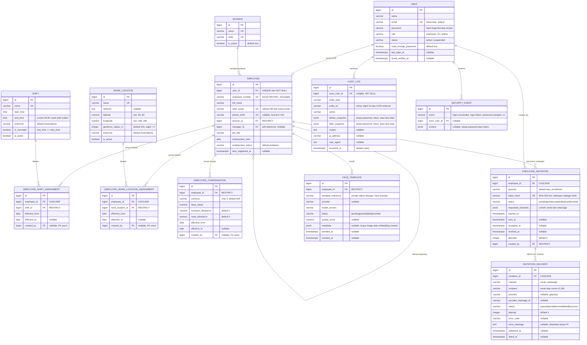

Catatan diagram: `AUDIT_LOG` dipakai bersama oleh kedua domain; untuk space digambar sekali pada ERD ini. Relasi `USER`—`AUDIT_LOG` (actor) dan `USER`—`SECURITY_EVENT` (actor) berlaku juga untuk seluruh aksi presensi/tugas/gaji.

#### 6.1.2 ERD Presensi, Tugas, Pengajuan & Gaji

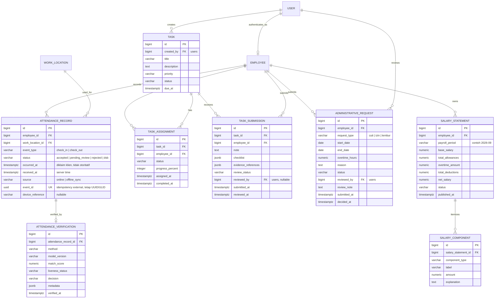

> Table `AUDIT_LOG`, `SECURITY_EVENT`, `WORK_LOCATION`, dan `EMPLOYEE` sudah ada di §6.1.1 dan berlaku untuk diagram ini juga (tidak digambar ulang). Untuk tabel domain presensi/tugas/gaji, kolom mengikuti definisi v1.0.0 dengan PK dikonversi ke `bigint`; perbedaan penting: `event_id` pada `attendance_records` tetap UUID sebagai idempotency key.


### 6.2 Additional Tables to Consider

| Table | Status di v1.1 | Purpose |
|---|---|---|
| `divisions`, `shifts`, `work_locations` | **Dari kandidat → target tabel inti** | Master data organisasi: divisi, shift (termasuk overnight), lokasi kerja + geofence. Dibahas penuh di §6.4. |
| `employee_shift_assignments`, `employee_work_location_assignments` | **Tabel inti baru** | Histori assignment dengan `effective_from`/`effective_to`; selalu ada tepat satu assignment aktif per jenis. |
| `employee_compensations` | **Tabel inti baru** | Paket kompensasi berlaku per periode; total bulanan dihitung server, tidak disimpan. |
| `employee_invitations`, `invitation_deliveries` | **Tabel inti baru** | Menggantikan `invitation_codes`: undangan registrasi wajah per purpose + riwayat pengiriman per channel untuk audit. |
| `face_templates` | Siap | Sekarang terikat invitation flow; hanya menyimpan `template_reference` (tanpa raw biometrik), dengan satu template `active` per employee. |
| `audit_logs` | Siap | Append-only; pencatatan aksi HR/employee yang consequential (bukan telemetri auth — itu `security_events`). |
| `devices` | Kandidat | Registrasi/perangkat tepercaya jika binding device diwajibkan. |
| `sync_batches` | Kandidat | Pelacak batch sinkronisasi presensi offline. |
| `attendance_correction_requests` | Kandidat | Koreksi presensi melalui workflow, bukan overwrite. |
| `request_attachments`, `task_attachments` | Kandidat | Metadata dokumen/bukti di storage privat. |
| `notifications` | Kandidat | Notifikasi in-app dan status pengirimannya. |
| `salary_publication_events` | Kandidat | Log terpisah aksi publikasi payroll. |
| `personal_access_tokens` (atau padanannya) | Ada | route Sanctum token; token dicabut saat suspend/terminate. |
| `sessions`, `password_reset_tokens` | Ada (default Laravel) | Kredensial reset memakai tabel ini; token disimpan sebagai hash. |

### 6.2.1 Tabel Lama yang Diubah atau Dihapus — *baru di v1.1*

| Tabel lama / kolom lama | Keputusan v1.1 | Alasan |
|---|---|---|
| `invitation_codes` | **Dihapus**; digantikan `employee_invitations` + `invitation_deliveries` | Fungsi kodenya (aktivasi akun) dimasukkan ke flow HR create; undangan v1.1 punya expiry, hash token, channel, status, dan delivery per channel. Pre-production → data lama tidak dimigrasikan. |
| `employees.position` → `job_title` | Diubah | Konsistensi penamaan; `position` terlalu polisemik. |
| `employees.division` (string) → `division_id` (FK `divisions`) | Diubah | Master table mencegah divisi tipe-ketik bebas dan duplikat. |
| `employees.is_active` → `employment_status` | Diubah | Butuh state machine (§5.10): `probation`, `active`, `contract`, `terminated`. |
| `employees.name` → `full_name` | Diubah | Sinkron dengan `users.name` pada create/update. |
| `employees.phone` → `phone_e164` | Diubah | Format E.164 normal (contoh `+6281227453318`) agar bisa dipakai WhatsApp gateway langsung. |
| `users` tanpa `status` / `must_change_password` / `last_login_at` | **Ditambah** | Prasyarat password sementara + wajib ganti, suspensi akun, dan telemetri login. |
| PK UUID di seluruh ERD v1.0.0 | Diubah ke `bigint` | Sesuai keputusan final; UUID/ULID hanya untuk external id/idempotency. |

### 6.3 Persistence and Integrity Rules — diperbarui di v1.1

Aturan yang berlaku untuk seluruh skema (domain baru dan tertahan):

- **Primary key & tipe:** semua PK `bigint`; teks PostgreSQL (`varchar`, `text`, `timestamptz`, `date`, `time`, `numeric`, `jsonb`, `boolean`). UUID/ULID hanya untuk external id (`attendance_records.event_id`) atau idempotency key lintas layanan.
- **Timestamp** disimpan UTC (`timestamptz`) dan dirender lokal sesuai timezone organisasi; jam perangkat klien tidak pernah menjadi sumber kebenaran.
- **Email** disimpan lowercase dan unik (`users.email`, `employees.work_email`); **nomor WhatsApp** disimpan dalam format E.164 (contoh `+6281227453318`).
- **Status** memakai string + check constraint (bukan `ENUM` PostgreSQL) agar mudah dievolusi; contoh: `employment_status`, `invitation_status`, `delivery_status`, `face_template_status`, `user_role`, `user_status`.
- **Kardinalitas kunci:**
  - setiap employee punya tepat satu user (`employees.user_id NOT NULL UNIQUE`, `ON DELETE RESTRICT`);
  - user bisa berupa employee atau HR (HR tidak punya employee);
  - satu undangan aktif (`pending`/`sent`) per `(employee_id, purpose)` — partial unique index;
  - satu template wajah `active` per employee — partial unique index;
  - satu kompensasi aktif per employee — partial unique index `WHERE effective_to IS NULL`;
  - satu assignment aktif per jenis (shift / lokasi) per employee — partial unique index.
- **Assignment & kompensasi histori:** perubahan shift/lokasi/kompensasi menutup record lama dengan `effective_to` lalu membuat record baru; tidak ada update in-place untuk nilai yang berlaku ekonomis.
- **Idempotency:** event presensi tetap unik per `event_id`; job pengiriman undangan juga idempotent per `(invitation_id, channel, attempt)`.
- **Nilai uang** tipe `numeric`, tidak pernah binary float, dan **total kompensasi tidak disimpan** — dihitung server dari komponen.
- **Nomor sistem:** `employee_number` dibuat otomatis (`HM-` + nomor urut), unik, immutable, tidak pernah berasal dari payload klien.
- **Kredensial:** password disimpan hanya sebagai hash (Argon2id/bcrypt); token undangan disimpan hanya sebagai hash SHA-256 + pepper; total kompensasi… token dan password tidak pernah masuk log. Password sementara tidak pernah disimpan plaintext.
- **Biometrik:** tidak menyimpan raw face image/embedding di database kecuali ada keputusan eksplisit (§12.2); `face_templates.template_reference` menunjuk ke object storage privat/face provider.
- **Soft delete:** tidak dipakai untuk employee. Akhir hubungan kerja dinyatakan dengan `employment_status = terminated` plus kebijakan retensi; `employees.user_id` memakai `ON DELETE RESTRICT`.
- **Audit trail:** riwayat undangan dan delivery disimpan untuk audit (append-only di sisi aplikasi); aksi HR yang consequential masuk `audit_logs`, telemetri auth masuk `security_events` (§6.4).
- **FK:** semua relasi memakai FK dengan `ON DELETE` yang disengaja — `CASCADE` untuk data turunan teknis (assignment, undangan, delivery), `RESTRICT` untuk entitas dengan nilai historis/ekonomis (kompensasi, shift, lokasi, divisi, template), `SET NULL` untuk referensi aktor opsional (`manager_id`, `created_by`).

---

### 6.4 Spesifikasi Tabel Target — *baru di v1.1*

Semua tabel memakai `bigint` PK, timestamp `timestamptz` UTC, dan status string + check constraint. `jsonb` dipetakan ke kolom JSON/text di lingkungan uji SQLite (lihat §9.5). DDL ringkas berikut hanya untuk memperjelas constraint; bukan resep SQL final.

#### `users` — akun autentikasi

| Kolom | Tipe | Null | Default | Catatan |
|---|---|---|---|---|
| `id` | `bigint` PK | no | — | — |
| `name` | `varchar(255)` | no | — | Sinkron dengan `employees.full_name` saat create/update |
| `email` | `varchar(255)` | no | — | Lowercase, **unique**; source of truth untuk login |
| `password` | `varchar(255)` | no | — | Hash (Argon2id/bcrypt); tidak pernah plaintext |
| `role` | `varchar(32)` | no | `'employee'` | `employee` / `hr` / `admin`; ditetapkan backend, tidak dari payload |
| `status` | `varchar(32)` | no | `'active'` | `active` / `suspended` |
| `must_change_password` | `boolean` | no | `true` | Wajib ganti password saat login pertama |
| `last_login_at` | `timestamptz` | yes | — | Diperbarui pada `login.succeeded` |
| `email_verified_at` | `timestamptz` | yes | — | Verifikasi email disarankan, bukan prasyarat login (§15.2) |
| `remember_token` | `varchar(100)` | yes | — | Standar Laravel |
| `created_at`, `updated_at` | `timestamptz` | no | `now()` | — |

- Check: `role IN (...)`, `status IN (...)`.
- Alasan: `must_change_password` bersifat default-`true` supaya password sementara sistem tidak bisa dipakai terus; `status` memungkinkan suspensi tanpa soft delete.

#### `employees` — profil karyawan

| Kolom | Tipe | Null | Default | Catatan |
|---|---|---|---|---|
| `id` | `bigint` PK | no | — | — |
| `user_id` | `bigint` | no | — | FK `users.id`, `ON DELETE RESTRICT`, **unique** |
| `employee_number` | `varchar(32)` | no | — | **Unique**, format `HM-0251`, dibuat backend, immutable |
| `full_name` | `varchar(255)` | no | — | Disinkronkan dengan `users.name` |
| `work_email` | `varchar(255)` | no | — | **Unique**, salinan HR dari `users.email` |
| `phone_e164` | `varchar(20)` | yes | — | **Unique** (nullable); satu nomor WA untuk satu employee |
| `division_id` | `bigint` | no | — | FK `divisions.id`, `ON DELETE RESTRICT` |
| `job_title` | `varchar(255)` | no | — | Pengganti `position` |
| `manager_id` | `bigint` | yes | — | Self-FK `employees.id`, `ON DELETE SET NULL` |
| `employment_start` | `date` | no | — | Dasar `effective_from` assignment/kompensasi |
| `employment_status` | `varchar(32)` | no | `'probation'` | `active`/`probation`/`contract`/`terminated` |
| `face_registered_at` | `timestamptz` | yes | — | Diisi saat enrollment sukses |
| `created_at`, `updated_at` | `timestamptz` | no | `now()` | — |

- Index: `division_id`, `manager_id`, `employment_status`.
- Check: `employment_status IN (...)`; `manager_id <> id` (update) — cek cycle manager divalidasi di aplikasi (error `MANAGER_CYCLE`).
- Alasan: `user_id NOT NULL UNIQUE` karena HR selalu membuat akun bersama employee. Jika suatu saat perlu employee tanpa akun (import massal), gunakan mekanisme import terpisah — jangan menjadikan kolom nullable. `work_email` adalah salinan HR dari `users.email`; duplikasi sengaja untuk keterbacaan report MVP, alternatifnya view/trigger sinkronisasi (bisa diterapkan belakangan).

#### `divisions` — master divisi

| Kolom | Tipe | Null | Default | Catatan |
|---|---|---|---|---|
| `id` | `bigint` PK | no | — | — |
| `name` | `varchar(100)` | no | — | **Unique** |
| `code` | `varchar(32)` | no | — | **Unique** |
| `is_active` | `boolean` | no | `true` | — |
| `created_at`, `updated_at` | `timestamptz` | no | `now()` | — |

- Seed minimal: `Operasional` dan divisi lain yang dibutuhkan organisasi.
- Alasan: mengganti `employees.division` string bebas dengan FK supaya filter/report konsisten.

#### `shifts` — master shift

| Kolom | Tipe | Null | Default | Catatan |
|---|---|---|---|---|
| `id` | `bigint` PK | no | — | — |
| `name` | `varchar(100)` | no | — | **Unique** |
| `start_time` | `time` | no | — | — |
| `end_time` | `time` | no | — | — |
| `timezone` | `varchar(64)` | no | `'Asia/Jakarta'` | — |
| `is_overnight` | `boolean` | no | `false` | Turunan dari `end_time <= start_time` |
| `is_active` | `boolean` | no | `true` | — |
| `created_at`, `updated_at` | `timestamptz` | no | `now()` | — |

- Seed: `Pagi 08:00–17:00` (`is_overnight=false`), `Siang 13:00–22:00` (`false`), `Malam 21:00–06:00` (`true`).
- Alasan: shift malam lintas hari (21:00–06:00) tidak diakali dengan interval biasa; `is_overnight` (dan aturan presensinya) mengatasi ini. Radius/lokasi tidak disimpan di shift (lihat `work_locations`).

#### `work_locations` — master lokasi kerja + geofence

| Kolom | Tipe | Null | Default | Catatan |
|---|---|---|---|---|
| `id` | `bigint` PK | no | — | — |
| `name` | `varchar(255)` | no | — | **Unique**; contoh “Gudang Kalasan” |
| `address` | `text` | yes | — | — |
| `latitude` / `longitude` | `numeric(9,6)` | no | — | Check −90…90 / −180…180 |
| `geofence_radius_m` | `integer` | no | `100` | Check `> 0`; dipakai untuk presensi |
| `timezone` | `varchar(64)` | no | `'Asia/Jakarta'` | — |
| `is_active` | `boolean` | no | `true` | — |
| `created_at`, `updated_at` | `timestamptz` | no | `now()` | — |

- Alasan: radius geofence disimpan per lokasi, **bukan** per employee; lokasi berubah lebih sering daripada kebijakan radius.

#### `employee_shift_assignments` — histori assignment shift

| Kolom | Tipe | Null | Default | Catatan |
|---|---|---|---|---|
| `id` | `bigint` PK | no | — | — |
| `employee_id` | `bigint` | no | — | FK `employees.id`, `ON DELETE CASCADE` |
| `shift_id` | `bigint` | no | — | FK `shifts.id`, `ON DELETE RESTRICT` |
| `effective_from` | `date` | no | — | Saat create: `employment_start` |
| `effective_to` | `date` | yes | — | Diisi saat digantikan |
| `created_by` | `bigint` | yes | — | FK `users.id`, `ON DELETE SET NULL` |
| `created_at`, `updated_at` | `timestamptz` | no | `now()` | — |

- Index: partial unique `(employee_id) WHERE effective_to IS NULL`; `(employee_id, effective_from)`; `shift_id`.
- Check: `effective_to IS NULL OR effective_to >= effective_from`.
- Alasan: perubahan shift = tutup record lama + buat record baru → ada histori lengkap, tidak ada overwrite.

#### `employee_work_location_assignments` — histori assignment lokasi kerja

Identik dengan `employee_shift_assignments` dengan `work_location_id` FK `work_locations.id` (`ON DELETE RESTRICT`). Partial unique index `(employee_id) WHERE effective_to IS NULL` — satu assignment aktif. Saat ini satu employee satu lokasi aktif; multi-lokasi dibahas di §15.2 (open question).

#### `employee_compensations` — paket kompensasi (bukan slip gaji)

| Kolom | Tipe | Null | Default | Catatan |
|---|---|---|---|---|
| `id` | `bigint` PK | no | — | — |
| `employee_id` | `bigint` | no | — | FK `employees.id`, `ON DELETE RESTRICT` |
| `currency` | `char(3)` | no | `'IDR'` | — |
| `base_salary` | `numeric(15,2)` | no | — | Check `>= 0` |
| `transport_allowance` | `numeric(15,2)` | no | `0` | Check `>= 0` |
| `meal_allowance` | `numeric(15,2)` | no | `0` | Check `>= 0` |
| `effective_from` | `date` | no | — | Saat create: `employment_start` |
| `effective_to` | `date` | yes | — | — |
| `created_by` | `bigint` | yes | — | FK `users.id`, `ON DELETE SET NULL` |
| `created_at`, `updated_at` | `timestamptz` | no | `now()` | — |

- Index: partial unique `(employee_id) WHERE effective_to IS NULL`; `(employee_id, effective_from)`.
- Check: nominal `>= 0`; `effective_to IS NULL OR effective_to >= effective_from`.
- **Total tidak disimpan.** `total_monthly = base_salary + transport_allowance + meal_allowance` dihitung server dan hanya muncul di response.
- Alasan: tabel ini adalah **paket** kompensasi; slip bulanan tetap milik domain `salary_statements` (v1.0.0). Memisahkan keduanya (ADR 0006) membuat perubahan kompensasi memiliki riwayat tanpa mengubah slip yang sudah terpublikasi.
- Akses: dibatasi HR/payroll policy; employee melihat kompensasi sendiri hanya bila policy mengizinkan.

#### `employee_invitations` — undangan registrasi wajah

| Kolom | Tipe | Null | Default | Catatan |
|---|---|---|---|---|
| `id` | `bigint` PK | no | — | — |
| `employee_id` | `bigint` | no | — | FK `employees.id`, `ON DELETE CASCADE` |
| `purpose` | `varchar(32)` | no | `'face_enrollment'` | Purpose lain menanti kebutuhan produk |
| `token_hash` | `varchar(64)` | no | — | **Unique**; SHA-256 hex dari token 32-byte + pepper |
| `status` | `varchar(32)` | no | `'pending'` | `pending`/`sent`/`accepted`/`expired`/`revoked` |
| `requested_channels` | `jsonb` | no | `'["email","whatsapp"]'` | Pilihan HR |
| `expires_at` | `timestamptz` | no | — | Default +3 hari (setelah `created_at`); API menerima 1–14 hari |
| `sent_at` / `last_sent_at` | `timestamptz` | yes | — | Pengiriman pertama / terakhir |
| `accepted_at` | `timestamptz` | yes | — | — |
| `revoked_at` | `timestamptz` | yes | — | — |
| `attempts` | `integer` | no | `0` | Jumlah percobaan enrollment |
| `created_by` | `bigint` | no | — | FK `users.id`, `ON DELETE RESTRICT` |
| `created_at`, `updated_at` | `timestamptz` | no | `now()` | — |

- Index: unique `token_hash`; partial unique `(employee_id, purpose) WHERE status IN ('pending','sent')`; index `status`, `expires_at`, `employee_id`.
- Check: `expires_at > created_at`; `status IN (...)`.
- Alasan: token asli hanya dikirim ke email/WhatsApp; yang disimpan hanya hash (ADR 0007). Tabel ini **tidak** menyimpan password atau data biometrik.

#### `invitation_deliveries` — riwayat pengiriman per channel

| Kolom | Tipe | Null | Default | Catatan |
|---|---|---|---|---|
| `id` | `bigint` PK | no | — | — |
| `invitation_id` | `bigint` | no | — | FK `employee_invitations.id`, `ON DELETE CASCADE` |
| `channel` | `varchar(16)` | no | — | `email` / `whatsapp`; check |
| `recipient` | `varchar(255)` | no | — | Email atau nomor E.164 pada saat kirim |
| `provider` | `varchar(64)` | yes | — | Gateway yang dipakai; rancang abstraksi gateway, jangan hardcode |
| `provider_message_id` | `varchar(255)` | yes | — | Untuk dedupe webhook |
| `status` | `varchar(32)` | no | `'queued'` | `queued`/`sent`/`delivered`/`failed`/`bounced`; check |
| `attempt` | `integer` | no | `1` | Per channel |
| `error_code` | `varchar(64)` | yes | — | — |
| `error_message` | `text` | yes | — | Sanitized, tanpa PII |
| `sent_at` / `delivered_at` / `failed_at` | `timestamptz` | yes | — | — |
| `created_at`, `updated_at` | `timestamptz` | no | `now()` | — |

- Index: `(invitation_id, channel, status)`; unique `(invitation_id, channel, attempt)`.
- Alasan: **status delivery per channel terpisah**; kegagalan satu channel tidak mempengaruhi channel lain, undangan, atau akun employee. Riwayat ini memungkinkan HR audit pengiriman.

#### `face_templates` — template wajah (tanpa raw biometrik)

| Kolom | Tipe | Null | Default | Catatan |
|---|---|---|---|---|
| `id` | `bigint` PK | no | — | — |
| `employee_id` | `bigint` | no | — | FK `employees.id`, `ON DELETE RESTRICT` |
| `template_reference` | `varchar(255)` | no | — | Pointer ke private object storage / face provider |
| `provider` | `varchar(64)` | yes | — | — |
| `model_version` | `varchar(64)` | no | — | Versi model saat template dibuat |
| `status` | `varchar(32)` | no | `'pending'` | `pending`/`active`/`failed`/`revoked`; check |
| `quality_score` | `numeric(5,4)` | yes | — | — |
| `metadata` | `jsonb` | yes | — | Tanpa image/embedding mentah |
| `enrolled_at` | `timestamptz` | yes | — | — |
| `revoked_at` | `timestamptz` | yes | — | — |
| `created_at`, `updated_at` | `timestamptz` | no | `now()` | — |

- Index: partial unique `(employee_id) WHERE status = 'active'`; `(employee_id, status)`.
- Alasan: hanya satu template aktif per employee; riwayat dipegang untuk audit/rollback. Tidak ada raw biometrik di DB tanpa keputusan eksplisit (ADR §12.2); jika embedding kelak perlu disimpan, wajib aturan enkripsi-at-rest, isolasi kunci, retensi, dan penghapusan yang didokumentasikan dalam ADR baru (open question §15.2).

#### `audit_logs` — append-only log aksi consequential

| Kolom | Tipe | Null | Default | Catatan |
|---|---|---|---|---|
| `id` | `bigint` PK | no | — | — |
| `actor_user_id` | `bigint` | yes | — | FK `users.id`, `ON DELETE SET NULL` |
| `entity_type` | `varchar(100)` | no | — | Contoh `employee`, `invitation` |
| `entity_id` | `varchar(64)` | yes | — | String agar menampung bigint id atau UUID external |
| `action` | `varchar(100)` | no | — | Daftar minimal di bawah |
| `before_snapshot` / `after_snapshot` | `jsonb` | yes | — | Tanpa password/token/face data |
| `reason` | `text` | yes | — | — |
| `ip_address` | `varchar(45)` | yes | — | — |
| `user_agent` | `text` | yes | — | — |
| `recorded_at` | `timestamptz` | no | `now()` | — |
| `created_at`, `updated_at` | `timestamptz` | no | `now()` | — |

- Index: `(entity_type, entity_id)`, `actor_user_id`, `recorded_at`.
- Aksi minimal: `employee.created`, `employee.updated`, `employee.employment_status_changed`, `compensation.created`, `assignment.created`, `invitation.created`, `invitation.resent`, `invitation.revoked`, `invitation.accepted`, `face.enrolled`, `face.revoked`, `user.status_changed`, `password.reset`.
- Alasan: append-only, dipisahkan dari `security_events` (ADR 0008); snapshot boleh memuat data personal keuangan/HR, tapi tidak pernah password/token/biometrik.

#### `security_events` — telemetri autentikasi (tabel lama, ditambah event type)

Struktur tetap: `id`, `event` (string), `actor_user_id`, `context` (jsonb), `timestamps`. Event type minimal: `login.succeeded`, `login.failed`, `logout`, `password.changed`, `password.reset.requested`, `invitation.accepted`, `face.enrollment.succeeded`, `face.enrollment.failed`. Password/token tidak pernah disimpan di tabel ini.

#### SQL ringkas untuk constraint kunci

```sql
-- partial unique: tepat satu assignment/kompensasi aktif
CREATE UNIQUE INDEX one_active_shift_assignment
  ON employee_shift_assignments (employee_id) WHERE effective_to IS NULL;
CREATE UNIQUE INDEX one_active_location_assignment
  ON employee_work_location_assignments (employee_id) WHERE effective_to IS NULL;
CREATE UNIQUE INDEX one_active_compensation
  ON employee_compensations (employee_id) WHERE effective_to IS NULL;
-- undangan aktif per purpose, dan satu template wajah aktif
CREATE UNIQUE INDEX one_active_invitation
  ON employee_invitations (employee_id, purpose) WHERE status IN ('pending','sent');
CREATE UNIQUE INDEX one_active_face_template
  ON face_templates (employee_id) WHERE status = 'active';
```

> Untuk test SQLite in-memory: partial unique index didukung SQLite; jika Laravel schema builder tidak nyaman, tulis migration dengan raw SQL. `jsonb` dipetakan ke text/JSON, dan jangan pakai `citext`/ENUM PostgreSQL (lihat §9.5).

---

## 7. API Design & Typed Contracts

All endpoints use a versioned prefix, for example:

```text
https://api.<domain-anda>/api/v1
```

The exact domain must be chosen by the project team. Flutter and any HR dashboard use the same API contract. OpenAPI/Swagger should define request schemas, response schemas, validation errors, authentication requirements, and pagination.

### 7.1 Candidate Endpoint Catalog

> The table below is a candidate catalog, not the final contract. Implemented
> auth endpoints are pinned in `docs/openapi/auth.yaml`: `/api/v1/register`,
> `/api/v1/login`, `/api/v1/me`, and `/api/v1/logout`.

| Method | Endpoint | Purpose |
|---|---|---|
| `POST` | `/auth/login` | Authenticate a user. |
| `POST` | `/auth/logout` | Revoke the current session/token where supported. |
| `GET` | `/me` | Get authenticated user's profile and permissions. |
| `GET` | `/bootstrap` | Get minimum reference data and policy versions for client initialization. |
| `GET` | `/attendance/history` | Read own attendance history; HR access is policy-scoped. |
| `POST` | `/attendance/check-in` | Submit online check-in. |
| `POST` | `/attendance/check-out` | Submit online check-out. |
| `POST` | `/sync/attendance` | Submit offline attendance events in a batch. |
| `GET` | `/sync/changes?cursor=...` | Retrieve server changes after a cursor/version. |
| `GET` | `/hr/attendance/summary` | HR attendance metrics and anomaly summaries. |
| `GET` | `/hr/attendance/map` | Return authorized location events for HR monitoring. |
| `GET` | `/tasks` | List assigned tasks; HR views depend on role. |
| `POST` | `/tasks` | Create a task (HR/task manager). |
| `GET` | `/tasks/{id}` | Get task details if authorized. |
| `POST` | `/tasks/{id}/start` | Mark task in progress. |
| `POST` | `/tasks/{id}/submissions` | Submit progress, checklist, and evidence references. |
| `POST` | `/tasks/{id}/review` | Approve task submission or request revision. |
| `GET` | `/administrative-requests` | List requests visible to the current user. |
| `POST` | `/administrative-requests` | Submit cuti/izin/lembur request. |
| `POST` | `/administrative-requests/{id}/decision` | HR decision, with role and state validation. |
| `GET` | `/salary-statements` | List salary periods for the authenticated employee. |
| `GET` | `/salary-statements/{id}` | Read the caller's salary statement if authorized. |
| `POST` | `/hr/salary-statements/import` | Optional import endpoint; exact workflow to be decided. |
| `POST` | `/hr/salary-statements/{id}/publish` | Publish a salary statement (payroll permission required). |
| `POST` | `/face/enrollments` | Start enrollment/re-enrollment according to policy. |
| `GET` | `/face/template-version` | Return current enrollment/model policy version, if applicable. |
| `POST` | `/attendance-correction-requests` | Request attendance correction. |
| `POST` | `/attendance-correction-requests/{id}/decision` | HR decision on a correction request. |

This endpoint list is a proposed starting point, not an implemented contract. Endpoint naming and request/response schemas should be settled in OpenAPI before parallel frontend/backend work accelerates.

#### Endpoint baru v1.1 — Onboarding, Undangan, dan Auth — *baru di v1.1*

Semua path di bawah memakai prefix `/api/v1`. Authorization HR diverifikasi lewat policy (bukan sekadar menyembunyikan tombol); role tidak pernah diterima dari payload.

| Method | Endpoint | Aktor | Purpose |
|---|---|---|---|
| `POST` | `/api/v1/hr/employees` | HR | Create employee + akun + kompensasi + assignment shift/lokasi + undangan dalam satu transaksi (§7.5) |
| `GET` | `/api/v1/hr/employees/{id}` | HR | Detail employee, kompensasi aktif, assignment aktif, status undangan |
| `GET` | `/api/v1/hr/employees/create-options` | HR | Referensi untuk form: divisions, shifts, work locations, managers aktif |
| `POST` | `/api/v1/hr/employees/{id}/invitations` | HR | Resend/rotate undangan aktif (token baru; token lama direvoke) |
| `DELETE` | `/api/v1/hr/invitations/{id}` | HR | Revoke undangan |
| `GET` | `/api/v1/hr/invitations/{id}` | HR | Status undangan + delivery per channel |
| `POST` | `/api/v1/hr/employees/{id}/reset-password` | HR | Generate password sementara baru; ditampilkan sekali; `must_change_password=true` |
| `POST` | `/api/v1/invitations/{token}/accept` | Employee (login) | Validasi undangan untuk employee yang sedang login |
| `POST` | `/api/v1/face/enrollments` | Employee (login) | Enrollment wajah dengan token undangan |
| `POST` | `/api/v1/auth/login` | Public | `identifier` (email ATAU `employee_number`) + `password` + `device_name` |
| `POST` | `/api/v1/auth/change-password` | Authenticated | Untuk `must_change_password` / ganti password |
| `POST` | `/api/v1/auth/forgot-password` | Public | Kirim link reset |
| `POST` | `/api/v1/auth/reset-password` | Public (token) | Reset password dari link |
| `GET` | `/api/v1/me` | Authenticated | Profil + employee summary + status face enrollment + `must_change_password` |

Perubahan terhadap katalog lama:

- `POST /register` bersifat **deprecated** (digantikan HR-only flow di `POST /hr/employees`); dijadwalkan dihapus setelah repo mobile bermigrasi.
- `POST /auth/login` berubah bentuk request dari `email` menjadi `identifier` (§7.6); Flutter perlu pembaruan tipe request.
- `POST /face/enrollments` pada v1.0.0 bebas konteks; kini wajib membawa token undangan yang valid dan hanya boleh untuk employee yang login — hal ini juga membalik siapa yang boleh meng-trigger enrollment (§9.3).

### 7.2 Example: Check-in Request

```http
POST /api/v1/attendance/check-in
Authorization: Bearer <access-token>
Idempotency-Key: 55b3f4fc-267a-4ef8-9c38-8c351cfe7f70
Content-Type: application/json
Accept: application/json
```

```json
{
  "event_id": "55b3f4fc-267a-4ef8-9c38-8c351cfe7f70",
  "occurred_at": "2026-10-19T08:02:11+07:00",
  "device_reference": "registered-device-id",
  "location": {
    "latitude": -7.78,
    "longitude": 110.37,
    "accuracy_m": 20
  },
  "face_verification": {
    "verification_reference": "client-or-server-defined-reference"
  }
}
```

The fields above are illustrative. Location and face-verification fields must be finalized based on the privacy policy and selected AI topology. Client-supplied verification metadata is not trusted merely because it appears in the payload.

### 7.3 Example: Per-event Sync Response

```json
{
  "data": [
    {
      "event_id": "55b3f4fc-267a-4ef8-9c38-8c351cfe7f70",
      "status": "pending_review",
      "server_received_at": "2026-10-19T01:05:02Z",
      "reason_code": "OFFLINE_EVENT_REQUIRES_REVIEW"
    }
  ],
  "next_cursor": "attendance-sync-cursor"
}
```

A batch response should report results per event. One invalid event should not silently hide the status of the other events in the batch.

### 7.4 Example: Salary Statement Response

```json
{
  "data": {
    "id": "salary-statement-id",
    "period": "2026-09",
    "status": "published",
    "currency": "IDR",
    "components": [
      { "type": "base_salary", "label": "Gaji pokok", "amount": "5000000.00" },
      { "type": "allowance", "label": "Tunjangan", "amount": "500000.00" },
      { "type": "overtime", "label": "Lembur", "amount": "250000.00" },
      { "type": "deduction", "label": "Potongan", "amount": "100000.00" }
    ],
    "net_salary": "5650000.00"
  }
}
```

All names and monetary values in this example are fictional and illustrative. The backend must derive or validate the net amount according to the approved payroll data source and rules.

### 7.5 Example: Create Employee (HR) — *baru di v1.1*

Request `POST /api/v1/hr/employees`:

```json
{
  "full_name": "Putri Ramadhani",
  "email": "putri.r@sinarmetrik.co.id",
  "phone": "081227453318",
  "division_id": 1,
  "job_title": "Staf Admin Gudang",
  "manager_id": 12,
  "employment_start": "2026-10-12",
  "employment_status": "probation",
  "shift_id": 3,
  "work_location_id": 2,
  "compensation": {
    "base_salary": 4800000,
    "transport_allowance": 400000,
    "meal_allowance": 550000
  },
  "send_invitation": true,
  "invitation_channels": ["email", "whatsapp"],
  "invitation_expires_in_days": 3
}
```

Ketentuan request:

- `employee_number` **tidak ada** di request — dibuat backend; `password` **tidak ada** di request — dibuat backend; `total_monthly` **tidak ada** di request — dihitung server.
- `employment_status` opsional, default `probation`.
- `phone` dinormalisasi ke E.164 oleh server (input HR boleh format `081227453318`).
- `invitation_expires_in_days` default 3, rentang wajar 1–14.
- Jika `invitation_channels` memuat `whatsapp`, `phone` wajib ada (error validasi `PHONE_REQUIRED` sejenis).
- Idempotency: menerima header `Idempotency-Key` (format UUID) — replay mengembalikan hasil create pertama, bukan employee baru.

Response `201`:

```json
{
  "success": true,
  "data": {
    "employee": {
      "id": 251,
      "employee_number": "HM-0251",
      "full_name": "Putri Ramadhani",
      "work_email": "putri.r@sinarmetrik.co.id",
      "phone_e164": "+6281227453318",
      "division": { "id": 1, "name": "Operasional" },
      "job_title": "Staf Admin Gudang",
      "manager": { "id": 12, "full_name": "Budi Santoso", "employee_number": "HM-0012" },
      "employment_start": "2026-10-12",
      "employment_status": "probation"
    },
    "compensation": {
      "base_salary": "4800000.00",
      "transport_allowance": "400000.00",
      "meal_allowance": "550000.00",
      "total_monthly": "5750000.00",
      "currency": "IDR"
    },
    "shift_assignment": { "shift_id": 3, "name": "Malam 21.00–06.00", "is_overnight": true, "effective_from": "2026-10-12" },
    "work_location_assignment": { "work_location_id": 2, "name": "Gudang Kalasan", "effective_from": "2026-10-12" },
    "invitation": {
      "id": 88,
      "status": "pending",
      "requested_channels": ["email", "whatsapp"],
      "expires_at": "2026-10-27T09:00:00Z",
      "deliveries": [
        { "channel": "email", "recipient": "putri.r@sinarmetrik.co.id", "status": "queued" },
        { "channel": "whatsapp", "recipient": "+6281227453318", "status": "queued" }
      ]
    },
    "initial_password": "R7$vQz2mKp9wXa4t",
    "must_change_password": true
  }
}
```

- `initial_password` hanya muncul **satu kali** pada response create (dan pada response reset-password); tidak pernah disimpan plaintext, tidak dimasukkan ke log, tidak dibacakan lagi oleh `GET`.
- `total_monthly` adalah hasil perhitungan server, bukan input.
- Nilai dalam contoh fiktif; nomor `HM-0251` ilustratif untuk employee `id 251`.

### 7.6 Contoh kontrak login & change-password — *baru di v1.1*

`POST /api/v1/auth/login`:

```json
{ "identifier": "putri.r@sinarmetrik.co.id", "password": "R7$vQz2mKp9wXa4t", "device_name": "Android Pixel 7" }
```

Aturan:

- `identifier` menerima email ATAU `employee_number` (`HM-0251`). Deteksi: ada `@` → email, selain itu dicocokkan ke `employees.employee_number`. Tidak ada field `username`.
- Response sukses memuat `token`, `user`, dan `must_change_password`. Bila `must_change_password = true`, klien wajib mengarahkan ke halaman ganti password; endpoint lain selain `/auth/me`, `/auth/change-password`, `/auth/logout` menolak request dengan error `PASSWORD_CHANGE_REQUIRED`.
- Error selalu `INVALID_CREDENTIALS` (401) untuk kredensial salah tanpa membocorkan informasi lain; `ACCOUNT_SUSPENDED` (403) hanya diterapkan setelah kecocokan kredensial terverifikasi (pola yang sama dipakai layanan umum).
- Rate limit: throttle ketat per identifier + IP; percobaan dicatat sebagai `security_events.login.failed` (tanpa password).

`POST /api/v1/auth/change-password`:

```json
{ "current_password": "R7$vQz2mKp9wXa4t", "new_password": "...", "new_password_confirmation": "..." }
```

Setelah sukses: `must_change_password` menjadi `false`, `security_events.password.changed`, dan token sesi saat ini tetap (bisa dianggap sesi baru secara keamanan, ikut kebijakan rotasi).

### 7.7 Katalog error code minim — *baru di v1.1*

| Code | Retryable? | Konteks |
|---|---|---|
| `EMPLOYEE_NUMBER_TAKEN` | no | Race di generator nomor urut (harus dicegah oleh unique index + retry internal) |
| `EMAIL_TAKEN` | no | users/employees email unik |
| `PHONE_TAKEN` | no | Employees phone unik |
| `PHONE_REQUIRED` | no | Channel `whatsapp` dipilih tanpa `phone` |
| `MANAGER_NOT_ACTIVE` | no | Manager terminated/suspended/tidak employee |
| `MANAGER_SELF_REFERENCE` | no | Update employee berikut `manager_id = own id` |
| `MANAGER_CYCLE` | no | Graf manager membentuk lingkaran (divalidasi aplikasi) |
| `SHIFT_NOT_ACTIVE` / `WORK_LOCATION_NOT_ACTIVE` | no | Master data nonaktif |
| `INVITATION_EXPIRED` | no | expires_at terlewati |
| `INVITATION_REVOKED` | no | Sudah direvoke HR |
| `INVITATION_ALREADY_USED` | no | Sudah accepted |
| `INVITATION_EMPLOYEE_MISMATCH` | no | Bukan undangan milik employee yang sedang login |
| `FACE_ENROLLMENT_REQUIRED` | no | Aksi presensi ditolak belum ada template wajah aktif (jika policy) |
| `INVALID_CREDENTIALS` | no | Login gagal generik |
| `ACCOUNT_SUSPENDED` | no | User suspended |
| `PASSWORD_CHANGE_REQUIRED` | no | Guard terhadap endpoint selain change-password |

Error tetap memakai envelope `success`/`message`/`errors` dari `docs/openapi/auth.yaml`; code diletakkan di `errors.code` (atau field export `code`) agar klien Flutter menampilkan pesan lokal.

### 7.8 Dampak ke `docs/openapi/auth.yaml` — *baru di v1.1*

- `LoginRequest` berubah dari `email`+`password` menjadi `identifier`+`password` (+ `device_name`); `AuthSuccessResponse.data` ditambah `must_change_password`.
- `RegisterRequest` (`/register`) ditandai **deprecated**.
- Schema tambahan: `CreateEmployeeRequest`, `CreateEmployeeResponse` (termasuk `initial_password` + status undangan/delivery), `InvitationResource`, `ChangePasswordRequest`, `ForgotPasswordRequest`, `ResetPasswordRequest`.
- Versi kontrak dinaikkan (mis. `0.2.0`) dan `docs/openapi/README.md` diperbarui saat endpoint pertama dari desain ini diimplementasikan.

---

## 8. Offline Sync, Idempotency & Runtime Guardrails

### 8.1 Mobile Outbox Pattern

The Flutter client should use SQLite/Drift or another tested local database for attendance events that may need to be synchronized later.

Each queued event should include, as applicable:

- `event_id` (UUID generated once and reused during retries)
- employee/session reference
- event type (`check_in` / `check_out`)
- device-captured time
- locally captured allowed metadata
- local state and retry metadata
- schema/policy version used at capture time

Suggested local states:

```text
CAPTURED_LOCAL
PENDING_SYNC
SYNCING
SYNCED
PENDING_REVIEW
REJECTED
SYNC_FAILED
```

The local status `SYNCED` means the server has returned a result for the event. The server decision may still be `PENDING_REVIEW`; therefore the application should not conflate successful transport with accepted attendance.

### 8.2 Idempotency Rules

- The mobile client generates one immutable `event_id` per attendance action.
- The same ID is reused for every retry of that action.
- The API stores the idempotency key with an appropriate unique constraint.
- If the same event is submitted again, the API returns the recorded result rather than creating another attendance record.
- The API validates employee ownership and rejects replay attempts that reuse an ID with materially different payload data.
- State transitions and persistence should be transactional.
- *Ditambah v1.1:* `POST /api/v1/hr/employees` dan pengiriman undangan juga idempotent — header `Idempotency-Key` (UUID/ULID) atau kunci `(invitation_id, channel, attempt)`; retry HR tidak membuat dua employee atau mengirim undangan ganda.

### 8.3 Retry, Timeout and Batch Limits

Initial values below are tuning candidates, not final production commitments:

| Parameter | Initial proposal | Enforcement |
|---|---|---|
| Connect timeout | 10 seconds | HTTP client/API gateway configuration. |
| API response timeout | 20–30 seconds for ordinary requests | Keep long AI/file work out of synchronous requests when possible. |
| Batch size | Start with a modest limit (e.g. 50 events/request) | Validate maximum payload and per-event cost. |
| Retry | Exponential backoff with jitter for transient failures | Do not retry validation/authentication errors blindly. |
| Idempotency | Required for mutating/sync operations that may be retried | Unique key and transactional server-side logic. |
| AI latency | Set a budget after model benchmarking | Timeouts, bounded input, and explicit unavailable/failure states. |
| Background jobs | Redis queue or equivalent if needed | Idempotent jobs, bounded retries, dead-letter/error handling where available. |

### 8.4 Offline Policy Decision

The product owner must decide which of these policies applies:

1. **Provisional acceptance:** show that the event was recorded locally, then let the server accept or reject it after synchronization.
2. **Review required:** all offline events enter an HR review queue.
3. **Restricted offline mode:** offline check-in is allowed only for specific roles, sites, or time windows.

Whichever policy is chosen, the UI must communicate that a locally stored event is not yet verified by the server.

---

## 9. Face Recognition & Verification Architecture

Face recognition is a core application component, but the supplied description does not specify the model, embedding format, liveness technology, threshold, or inference location. Those decisions require evaluation.

### 9.1 Candidate Topologies

| Approach | Benefits | Risks / constraints |
|---|---|---|
| On-device inference | Can support offline user experience and reduce image upload volume. | Model extraction/manipulation, device variation, and client-result trust. |
| Server-side inference | Centralized model versioning, thresholds, and verification rules. | Network dependency, privacy implications of uploading biometric samples, server inference cost. |
| Hybrid | Local feedback plus server-side verification when connected. | More complex state management; local result must not be treated as authoritative evidence. |

### 9.2 Recommended Integration Boundary

Use a Laravel interface/service such as `FaceVerificationProvider` to decouple attendance rules from the selected model and runtime. If inference uses Python, Laravel calls a private FastAPI service through a documented service contract.

Example conceptual response:

```json
{
  "decision": "match",
  "match_score": 0.91,
  "liveness": "verified",
  "model_version": "model-version-id",
  "verification_reference": "verification-id"
}
```

This is only an illustrative shape. The actual model output and decisions must be calibrated and validated; a numeric threshold or a `match` value alone must never be assumed to establish liveness.

### 9.3 Enrollment and Lifecycle — dirancang ulang di v1.1

Enrollment wajah kini **terikat undangan** (`employee_invitations`, purpose `face_enrollment`) yang dibuat HR bersamaan dengan create employee. Semua pertanyaan klasik di bawah ini dijawab oleh desain v1.1:

| Pertanyaan desain (v1.0) | Keputusan v1.1 |
|---|---|
| Siapa yang boleh enroll / re-enroll? | Karyawan itu sendiri, hanya ketika **sedang login**. HR hanya membuat / re-send / revoke undangan; tidak ada enroll atas nama orang lain. Re-enrollment memakai undangan baru dengan purpose yang sama; partial unique memastikan hanya satu undangan aktif per purpose. |
| Bagaimana identitas diverifikasi sebelum enroll? | Tiga lapis: (1) sesi login (email/`HM-###` + password, setelah menyelesaikan `must_change_password`), (2) validasi token undangan — hash cocok, belum expired/revoked/accepted, `employee_id` undangan = employee yang sedang login — constant-time compare, dan (3) pemeriksaan `face_templates` tidak ada yang `active`. |
| Bagaimana kualitas capture dinilai? | `quality_score` dikembalikan `FaceVerificationProvider` saat enrollment; bila di bawah ambang, template `failed`, undangan tetap `pending`, bisa dicoba lagi sampai expiry. |
| Model/version mana yang membuat template? | `face_templates.model_version` + `provider` tercatat per row; verifikasi presensi menolak template yang versinya tidak didukung (lihat v1.0.0 §9.4). |
| Bagaimana template dicabut/dihapus? | `ACTIVE → REVOKED` saat terminasi/suspensi atau revoke wajah yang explicitly dilakukan HR; job housekeeping menghapus objek di private storage/face provider sesuai retensi (kebijakan waktu: §15.2). `face_registered_at` pada `employees` dipertahankan untuk kejelasan. |
| Bagaimana penggantian model dievaluasi/roll-out? | Re-enrollment massal dilakukan lewat `invite` dengan batch undangan baru; rotasi per divisi/lokasi supaya tidak ada dua versi model dalam waktu terlalu lama. |
| Bagaimana false match/exception ditangani? | Template `failed`/`revoked` dipertahankan sebagai riwayat + kejadian dicatat ke `security_events.face.enrollment.failed`; undangan `pending` bisa dicoba ulang; kasus tak terduga diarahkan ke antrean review HR. |

Baris tambahan yang prudensial untuk diingat:

- Link undangan **bukan** mekanisme login; karyawan harus login terlebih dahulu dan hanya kemudian bisa accept undangan miliknya sendiri (`INVITATION_EMPLOYEE_MISMATCH` bila mismatch).
- Password sementara **tidak dikirim** di email/WhatsApp yang sama dengan link undangan (lihat §12.6); HR menyampaikannya lewat kanal terpisah.
- Scheduler menandai undangan setelah lewat `expires_at`, tetapi endpoint accept tetap memvalidasi expiry supaya race aman.
- Log audit minimal atas aksi biometrik: `face.enrolled`, `invitation.accepted`, plus `security_events.face.enrollment.succeeded|failed`.

### 9.4 Model Evaluation Requirements

Evaluate at minimum:

- False Acceptance Rate (FAR) and False Rejection Rate (FRR).
- Performance across lighting, camera quality, pose, and relevant user groups.
- Liveness / anti-spoofing performance against printed photos, replayed images, and other plausible attacks.
- Enrollment failure rate and quality thresholds.
- Threshold calibration using representative validation data.
- Behavior under offline operation and model/version mismatch.

Do not claim production-grade accuracy until these measures are tested on representative data.

### 9.5 Rencana Migrasi Skema v1.1 — *baru di v1.1*

Migration tetap terpusat di `database/migrations/` (ADR 0001). Urutan (setiap langkah punya `down()` yang reversible):

1. `create_divisions_table`
2. `create_shifts_table`
3. Pastikan/ubah `work_locations` (tambah `timezone`, check latitude/longitude/radius; tabel ini mungkin sudah ada untuk presensi)
4. `update_users_table` — tambah `status` (default `active`), `must_change_password` (default `true`), `last_login_at`
5. `update_employees_table` — tambah `user_id` (unique, FK RESTRICT), `full_name`, `phone_e164`, `division_id` (FK), `job_title`, `employment_start`, `employment_status` (default `probation`), `face_registered_at`; hapus `position`, `division`, `is_active` **setelah** backfill
6. `create_employee_shift_assignments_table`
7. `create_employee_work_location_assignments_table`
8. `create_employee_compensations_table`
9. `create_employee_invitations_table`
10. `create_invitation_deliveries_table`
11. `update_face_templates_table` — tambah `quality_score`, `metadata`, `provider`; pastikan partial unique `one_active_face_template`
12. `create_audit_logs_table`
13. `update_security_events_table` — event type baru (indeks `event` sudah ada); tambah unique/per event bila perlu dedup
14. `drop_invitation_codes_table`
15. Seed: divisions, shifts (3 shift contoh), work_locations, user HR

**Backfill (urutan setelah semua tabel jadi):**

- `invitation_codes` lama **tidak dimigrasikan** — pre-production, aman dihapus (step 14).
- Employee lama tanpa `user_id`: buat akun lewat flow HR yang sama (password sementara + wajib ganti saat login pertama) atau reset password manual; prosedurnya didokumentasikan bersama migration.
- Employee lama dengan `division` string → map ke `divisions` (buat division bila tidak ada match, laporan mapping).
- `position` → `job_title` (copy 1:1).
- `is_active` → `employment_status`: `true` → `active`, `false` → `terminated` (keputusan mapping nontrivial lain dicatat bersama migration).
- `phone` → `phone_e164` (dengan normalisasi + laporan nomor yang gagal normalisasi).
- `users.email` lama → seragamkan ke lowercase.

**Rollback:** setiap migration punya `down()`; rename kolom dilakukan dua-arah (ada backfill + script balik), `drop_invitation_codes` adalah langkah terakhir sehingga rollback lanjutan masih memungkinkan.

**Kendala testing SQLite in-memory:**

- Hindari `citext`, `ENUM`, dan fitur PostgreSQL-only. Lowercase email ditegaskan di aplikasi, bukan di DB.
- Partial unique index: didukung SQLite; tulis raw SQL di migration bila builder kurang nyaman.
- `jsonb` → kolom `json`/`text` pada SQLite; `time`, `date`, dan timestamp `timestamptz` didukung Laravel schema builder.

---

## 10. Human Approval, Roles & Workflow Enforcement

HadirMetrik contains several workflows that should not be reduced to arbitrary status updates from the client.

### 10.1 Role and Permission Model

Suggested roles or permission groups:

| Role / permission group | Typical permissions |
|---|---|
| Employee | Access own profile, own attendance, assigned tasks, own requests, and own published salary statements. |
| HR attendance | View authorized attendance overview, review anomalies, decide attendance corrections. |
| HR task manager | Create/assign tasks and review submissions within assigned organizational scope. |
| HR approver | Decide permitted leave/permission/overtime requests. |
| Payroll manager | Import/manage salary statement data and publish statements. |
| System administrator | Manage system-level configuration and roles; should not automatically receive unrestricted payroll access unless required. |

A user may hold multiple permission groups. Exact roles and organizational scopes need product-owner approval.

**Catatan v1.1:** untuk MVP, v1.1 memodelkan **role tunggal pada `users.role`** (`employee` / `hr` / `admin`) + policy berbasis permission per modul:
- Registrasi/undangan/create-employee hanya untuk role `hr` (dan admin) — ditegakkan lewat policy, bukan UI.
- Role selalu ditetapkan backend dan tidak pernah dibaca dari payload (atauran ini eksplisit sejak M1 di roadmap).
- Employee/pengguna tanpa profil karyawan (mis. akun HR) tidak dapat melakukan enrollment maupun presensi sehingga data biometrik/kehadiran selalu milik profil karyawan yang valid.
- Jika HR juga perlu berperan sebagai reviewer/approver task/request (sesuai tabel di atas), tambahkan permission granular tanpa mengubah kolom `role`.

### 10.2 Approval Gate Rules

For any HR decision endpoint, the backend should enforce:

1. Authentication of the acting user.
2. Authorization for the relevant action and organizational scope.
3. State assertion: the target record is in a decision-eligible state.
4. Idempotency: the same decision cannot be applied more than once.
5. Validation of required reason, dates, hours, or supporting data.
6. Transactional persistence of decision and audit event.
7. A notification or in-app status update if configured.

HR approval should not be inferred from hiding or showing buttons in the UI. The API remains authoritative.

### 10.3 Audit Log Semantics

Audit events should cover important actions such as attendance review/correction, task assignment/review, request decisions, employee account changes, enrollment changes, and salary statement publication.

For the initial architecture, audit logging is **not claimed to be cryptographically tamper-proof**. Recommended controls:

- Append-only behavior for the application database role where practical.
- Store actor ID, action, target entity, server timestamp, reason, and relevant before/after snapshots.
- Restrict direct database access and monitor privileged operations.
- Define retention and access policy for audit logs, since snapshots may contain personal or financial information.

---

## 11. Single-Domain Strategy & Deployment Topology

The mobile and backend repositories can remain separate while production services use a common domain family. The actual domain is not specified yet; examples below use placeholders.

### 11.1 Domain Map

```text
https://<domain-anda>          -> Public information site, if any
https://app.<domain-anda>      -> HR web dashboard, if implemented separately
https://api.<domain-anda>      -> Laravel REST API
```

Flutter does not require its own website domain. It calls `https://api.<domain-anda>/api/v1`.

Python FastAPI, PostgreSQL, Redis, and object storage should not be publicly exposed just to achieve one domain. Keep internal services on the private network, or use service authentication and restrictive network controls where private networking is unavailable.

### 11.2 Example Deployment Diagram

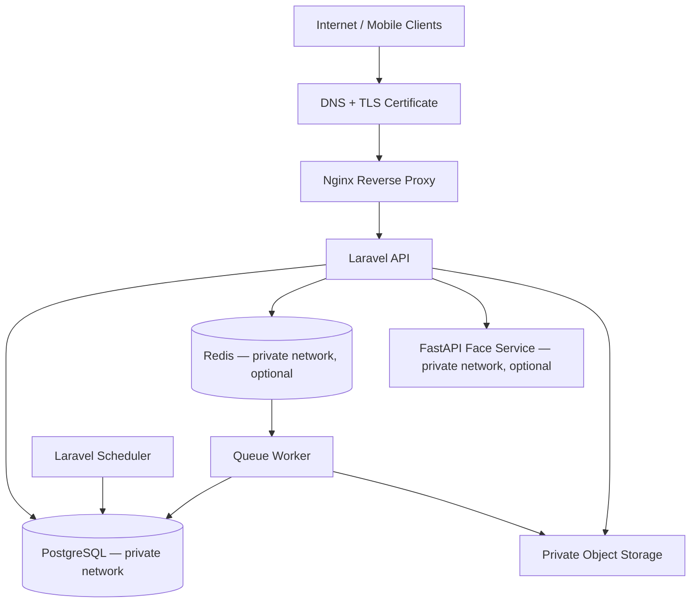

### 11.3 Routing Notes

For a single-VPS deployment:

- Nginx terminates TLS and proxies `api.<domain>` traffic to the Laravel API or serves Laravel through PHP-FPM.
- The API should be versioned and enforce authentication and authorization.
- Database, Redis, and AI service ports should not be exposed to the public internet.
- Configure trusted proxy settings correctly so Laravel recognizes HTTPS and client IP headers.
- If the HR dashboard is a separate web application, route `app.<domain>` to that application; it still calls the same API.
- If no HR web dashboard is required, omit the `app.` subdomain.

### 11.4 Docker Compose Service Candidates

```text
nginx
laravel-app / php-fpm
laravel-queue-worker       # when queue is enabled
laravel-scheduler
postgres
redis                      # optional
face-ai-service            # optional
```

Object storage may be managed externally or deployed privately. The actual VPS sizing must be based on concurrency, biometric inference placement, request volume, and load testing. Any initial CPU/RAM estimate is only a test starting point, not a capacity guarantee.

---

## 12. Security, Privacy & Compliance Controls

HadirMetrik handles face biometrics, attendance times, possible location data, task records, administrative documents, and salary data. These data types require explicit access controls and lifecycle policies.

### 12.1 Application Security Baseline

- HTTPS for all external traffic.
- Secure session/token lifecycle; store mobile tokens in platform secure storage.
- Role- and scope-based authorization on every protected resource.
- Object-level authorization for employee-owned attendance, tasks, requests, and salary statements.
- Request validation, rate limits, upload restrictions, and safe error responses.
- Idempotency and replay controls for attendance/sync endpoints.
- Strong password hashing and appropriate authentication protections.
- Secrets outside source control and restricted production access.
- Database backups, tested restoration, monitoring, and incident-response procedures.
- Dependency updates, CI tests, and security review before production.

**Ditambahkan di v1.1:**

- Login dengan rate limit ketat per identifier + IP, lockout bertingkat, pesan error generik, pencatatan `last_login_at`, dan `security_events` untuk setiap percobaan.
- Password sementara: 16 karakter acak, ditampilkan sekali, hash Argon2id/bcrypt, tidak pernah di-log, wajib diganti saat login pertama (`must_change_password`).

### 12.2 Biometric Data

- Decide whether the system needs raw face images, embeddings, or both.
- Minimize the stored biometric data and restrict who can view/export it.
- Encrypt sensitive data at rest where appropriate and enforce TLS in transit.
- Define retention, revocation, and deletion procedures.
- Do not put face images, embeddings, tokens, or sensitive personal details into general-purpose logs.
- Restrict any evidence URL; use private storage and short-lived authorization where appropriate.
- Review the legal basis, notice/consent process where applicable, retention purpose, and employee rights before collection.

### 12.3 Location and HR Monitoring

- Define whether GPS is mandatory, optional, or only a risk signal.
- Define permitted collection times and whether location is collected only at check-in/check-out.
- Show HR only the locations and employee records within their authorized scope.
- Store location precision only to the level needed for policy enforcement.
- Do not describe a location as “real-time” unless the product actually collects and transmits live location. The supplied description mentions real-time monitoring, but the collection interval and technical behavior must be specified.

### 12.4 Salary and Employment Data

- Apply strict object-level authorization for salary statements.
- Separate payroll management permissions from general HR permissions if the organization requires it.
- Record creation, import, correction, and publication history.
- Avoid exposing downloadable salary files through public URLs.
- Define retention and handling for payroll data and request attachments.

### 12.5 Regulatory Review

Before production, review applicable Indonesian personal-data protection requirements, including **UU No. 27 Tahun 2022 tentang Pelindungan Data Pribadi**, and any other employment, payroll, or sector-specific requirements that apply to the organization. This document is an architecture proposal, not legal advice or a statement of completed compliance.

### 12.6 Kredensial Sementara, Token Undangan, dan Pengiriman — *baru di v1.1*

**Password sementara (HR create / reset-password):**

- Dibuat sistem (bukan oleh HR), 16 karakter acak dari CSPRNG; ditampilkan **sekali** pada response create/reset; disimpan hanya sebagai hash (Argon2id/bcrypt).
- Tidak pernah ditulis ke log — log aplikasi, `security_events`, `audit_logs`, dan log HTTP semuanya memfilter/masking field sensitif.
- `must_change_password = true` memaksa pergantian password melalui `/auth/change-password` sebelum fitur lain dapat diakses (guard §5.9).
- HR menyampaikannya lewat kanal terpisah (mis. panggilan/pertemuan langsung) — **tidak** dirangkai di email/WhatsApp undangan.

**Token undangan:**

- 32 byte random (CSPRNG); disimpan sebagai **hash SHA-256 + pepper** (pepper di environment server); perbandingan hash memakai constant-time compare.
- One-time use; expiry default 3 hari; dapat direvoke; resend **merotasi** token (undangan lama menjadi `revoked`, dibuat undangan baru).
- Link memakai `https://api.<domain>/…` dengan header `Referrer-Policy: no-referrer`, tidak muncul di analytics/log, dan disarankan pattern exchange: setelah employee login, token dipertukarkan dengan operasi server-side tanpa token tersentuh klien lagi.

**Pengiriman (email/WhatsApp):**

- Semua kirim memakai queue worker, idempotent per `(invitation_id, channel, attempt)`; retry membuat attempt baru.
- Webhook delivery memverifikasi signature dan deduplikasi lewat `provider_message_id`.
- Kegagalan satu channel tidak memengaruhi akun, undangan, atau employee — hanya status di `invitation_deliveries`.
- Isi pesan tidak pernah memuat password; saran isi: nama karyawan, keterangan login dengan identifier (email/`employee_number`), batas waktu link undangan, dan instruksi registrasi wajah. PII dalam pesan dijaga seminimal mungkin.

**Kepatuhan data:** wajah dapat dianggap data pribadi yang bersifat spesifik menurut UU No. 27/2022 — sehingga wajib ada alur consent saat onboarding, retensi/penghapusan template saat termination/revocation sesuai kebijakan retensi (open question §15.2), dan pencatatan audit yang dapat dipertanggungjawabkan (`audit_logs`: aktor, IP, user agent, before/after, reason).

---

## 13. Evaluation & Verification Framework

The release should be gated by automated tests and operational checks. Quantitative acceptance thresholds should be set with the project stakeholders and measured against representative test data.

### 13.1 Business Workflow Tests

1. **Attendance rules:** schedule boundary, duplicate check-in/out, late arrival, missing check-out, location policy, and corrections.
2. **Task workflow:** assignment, progress update, evidence submission, review, revision, completion, and unauthorized transitions.
3. **Administrative requests:** valid/invalid date ranges, leave/permission/overtime rules, approval, rejection, and repeated decision.
4. **Salary transparency:** period listing, decimal arithmetic, publication state, unauthorized cross-employee access, and statement revisions.
5. **RBAC / organization scope:** employee, HR reviewers, approvers, payroll managers, and administrative permissions.

### 13.2 Offline and Integration Tests

- Loss of network during capture, upload, and response.
- App termination/restart while records are pending.
- Duplicate batch submission and partial batch failures.
- Timezone and device-clock manipulation.
- Invalid/expired token on reconnect.
- Model-version or policy-version mismatch.
- AI service unavailable or timing out.
- Database, queue, and object-storage failures.

### 13.3 Face Verification Tests

- FAR and FRR under representative conditions.
- Liveness / anti-spoofing attacks and false liveness acceptance.
- Lighting, device camera, pose, and relevant user-group variation.
- Enrollment quality and re-enrollment.
- Reproducible evaluation using a documented validation dataset.
- Safe fallback behavior when verification is uncertain or unavailable.

### 13.4 Operational Readiness

- Load test around expected morning check-in and end-of-day check-out peaks.
- Monitor API latency/error rate, queue backlog, sync failure rate, AI latency, and disk usage.
- Validate backup restoration and disaster-recovery steps.
- Review audit log retention and privileged access.
- Verify TLS renewal, secret rotation, dependency patching, and deployment rollback.

### 13.5 Proposed Release Gates

Use stakeholder-approved targets rather than unvalidated claims. Candidate release gates include:

- No duplicate attendance records under repeated retry tests.
- No cross-employee exposure of salary data in authorization tests.
- All consequential approval and correction actions generate audit entries.
- The offline sync suite passes app restart, network failure, and partial-batch scenarios.
- Face verification is not released as an authoritative attendance control until model and liveness performance have been evaluated on representative data.
- Restore from backup is successfully tested before production.

---

## 14. Implementation Phases

### Phase 1 — Architecture and Contracts
- Confirm roles, approval rules, attendance policy, payroll source of truth, and dashboard platform.
- Create separate mobile and backend repositories.
- Define API contracts in OpenAPI and agree on error/status semantics.
- Establish Laravel, PostgreSQL, authentication, authorization, CI, and development environments.

### Phase 2 — Core Identity and Attendance
- Implement users/employees, schedules, work locations, attendance events, history, and audit logs.
- Implement server validation, idempotency, and attendance correction workflows.
- Build Flutter attendance UI and API integration.

### Phase 3 — Offline Synchronization
- Add local database/outbox to Flutter.
- Implement batch synchronization, per-event results, retry, idempotency, and review policy.
- Test offline capture with network transitions and app restarts.

### Phase 4 — Face Verification
- Evaluate candidate models and on-device/server/hybrid deployment.
- Implement enrollment lifecycle and verification adapter.
- Benchmark match quality and liveness before making the system production-authoritative.

### Phase 5 — Tasks and Administrative Requests
- Implement task assignment, progress, checklist/evidence, review, and revision.
- Implement cuti/izin/lembur submission, attachments, approval, and status tracking.
- Add optional notifications.

### Phase 6 — Salary Transparency and HR Reporting
- Confirm payroll source of truth and importing/publication workflow.
- Implement salary statement components, employee-scoped visibility, and audit history.
- Implement HR metrics, lateness trends, authorized location views, and approval queues.

### Phase 7 — Hardening and Production
- Complete access-control, biometric-privacy, load, backup/restore, and failure-mode tests.
- Deploy behind HTTPS and restrict internal service exposure.
- Pilot with a limited employee group, collect measured results, and resolve issues before wider rollout.

---

## 15. Decisions Required Before Implementation Is Frozen

The application description identifies the major features and primary users, but the following implementation details remain undefined:

1. **HR client platform:** Flutter-only role-specific UI, separate HR web dashboard, or both?
2. **Face-recognition deployment:** on-device, server-side, or hybrid?
3. **Liveness:** what anti-spoofing method is required, and what evidence supports its performance?
4. **Offline attendance policy:** provisional acceptance, HR review, or restricted offline use?
5. **Location policy:** mandatory GPS, geofence radius, permitted collection times, and accuracy requirements?
6. **Salary source of truth:** manual HR entry, import from payroll software, or a direct integration?
7. **Payroll rules:** Is the application only displaying finalized payroll data, or is it expected to calculate payroll?
8. **Task model:** individual assignment only or group tasks, recurring tasks, comments, and attachments?
9. **Approval hierarchy:** single HR approver, supervisor-first, multiple stages, delegation, and cancellation rules?
10. **Biometric lifecycle:** enrollment authority, retention, re-enrollment, revocation, and deletion process?
11. **Expected scale:** number of employees, peak concurrent attendance, attachment sizes, and data retention period?
12. **Domain and hosting:** selected root domain, VPS/cloud provider, environment topology, and backup policy?

These decisions should be captured as Architecture Decision Records (ADRs) and reflected in the API contract and database migrations.

### 15.1 Keputusan yang Difinalkan di v1.1 + ADR — *baru di v1.1*

Keputusan final v1.1 dieksplisitkan dan masing-masing punya ADR:

| Keputusan | ADR |
|---|---|
| PK `bigint` untuk semua tabel; `employee_number` business key unik, dibuat otomatis backend (format `HM-0251`), immutable, dipakai login | `docs/adr/0002-autogenerated-employee-number.md` |
| Password sementara dibuat sistem, ditampilkan sekali, wajib ganti di login pertama; tidak dikirim bersama link undangan | `docs/adr/0003-system-generated-temporary-password.md` |
| Registrasi HR-only; flow register publik lama dihapus/deprecated; akun dibuat oleh HR dalam satu transaksi bersama employee | §4.6 + ADR 0002 |
| Divisi sebagai master table (`divisions`), FK pada `employees.division_id` | `docs/adr/0004-division-master-table.md` |
| Assignment shift & lokasi dengan `effective_from`/`effective_to` (histori, satu aktif per jenis) | `docs/adr/0005-effective-dated-assignments.md` |
| Kompensasi terpisah (`employee_compensations`), total dihitung server, terpisah dari `salary_statements` | `docs/adr/0006-compensation-packages-vs-salary-statements.md` |
| Token undangan disimpan hash + pepper, one-time, revoke/rotation pada resend; delivery per channel | `docs/adr/0007-invitation-token-hash-and-rotation.md` |
| Pemisahan `security_events` (telemetri auth) vs `audit_logs` (aksi consequential) | `docs/adr/0008-security-events-vs-audit-logs.md` |
| Login pakai `identifier` (email ATAU `employee_number`); username bukan kredensial | ADR 0002 (identifier login) |

Item lama di daftar §15 yang **belum** ditutup v1.1 tetap terbuka: HR client platform, topologi face recognition, liveness, offline policy, salary source of truth, dsb.

### 15.2 Open Questions Baru (v1.1) — *baru di v1.1*

| # | Pertanyaan | Rekomendasi |
|---|---|---|
| 1 | Apakah login diblokir sampai face enrollment selesai? | **Tidak.** Login boleh; presensi diblokir (`FACE_ENROLLMENT_REQUIRED`) sampai ada template aktif. Kontrasnya: fitur non-kehadiran tetap dipakai. |
| 2 | Apakah email wajib diverifikasi? | Ya, disarankan; HR menetapkan email valid, verifikasi mengurangi salah-alamat undangan; `email_verified_at` sudah disiapkan. |
| 3 | Apakah nomor WhatsApp wajib? | Wajib hanya bila channel WhatsApp dipilih di undangan; opsional bila hanya email. |
| 4 | Provider WhatsApp apa? | Rancang abstraksi gateway generik (send + status callback + delivery report) dan pilih provider/WSP saat implementasi; jangan hardcode vendor. |
| 5 | Apakah `employee_number` boleh diubah? | Tidak. Immutable; perubahan hanya lewat admin + audit. |
| 6 | Satu employee punya banyak lokasi kerja? | Saat ini satu assignment aktif per jenis; multi-lokasi bisa ditambahkan nanti dengan menambah baris assignment — schema tidak perlu berubah. |
| 7 | Payroll akan memakai komponen dinamis? | Bila ya, normalisasi `employee_compensations` menjadi tabel komponen (`compensation_components`) — desain saat ini sudah menjaga total server-side. |
| 8 | Retensi face template & audit log? | Belum diputuskan; usulan: template wajah & objek dihapus saat termination/`revoked` + `N hari` untuk riwayat metadata; `audit_logs` disimpan minimal 5 tahun per kebutuhan pelaporan — perlu konfirmasi kebijakan HR/legal. |
| 9 | HR reset password karyawan? | Ya, endpoint `POST /hr/employees/{id}/reset-password` telah diadakan: password sementara baru + tampil sekali + `must_change_password`; setiap reset tercatat di audit. |
| 10 | Verifikasi dua langkah (OTP) untuk HR? | Belum diputuskan; slot dijadwalkan setelah M9 security review. |

---

## 16. Architecture Baseline Summary

The proposed baseline for HadirMetrik is:

- **Polyrepo** for Flutter, Laravel, and any independently deployed AI/admin applications.
- **Flutter / Dart** for the mobile employee experience.
- **Laravel modular monolith** as the system of record for attendance, tasks, requests, salaries, permissions, and workflows.
- **PostgreSQL** as the primary database.
- **Redis and Laravel Queue** when asynchronous processing and notifications require them.
- **Python FastAPI** as a private, optional face-recognition service depending on the selected model and topology.
- **Versioned REST API + OpenAPI** as the integration contract between repositories.
- **One domain family**, with `api.<domain-anda>` as the public API endpoint and optional `app.<domain-anda>` for a separate HR dashboard.
- **Offline outbox and idempotent synchronization** for attendance events, with server-side validation.
- **Explicit state machines, role checks, and audit logs** for attendance review, task review, administrative requests, and salary publication.
- **Privacy-by-design** for biometric, location, employment, and financial information.

This is a production-minded starting point, not a claim that all features are already specified or implemented. Finalize the outstanding product decisions, then lock the API contracts, schema, and release acceptance criteria before large-scale parallel development.

---

## 17. Ringkasan Perubahan v1.1.0 & Acceptance Checklist — *baru di v1.1*

### 17.1 Ringkasan perubahan

| Section | Perubahan |
|---|---|
| Header | Versi → 1.1.0; status direvisi; catatan revisi + referensi ADR |
| §4 | Flow baru 4.6–4.11: create employee HR (transaksi atomik), delivery email/WhatsApp + callback, login/ganti password/accept/enrollment, resend/revoke, scheduler expiry, terminasi |
| §5 | State machine baru: invitation (5.6), delivery (5.7), face template (5.8), user (5.9), employment (5.10) + guard |
| §6.1 | ERD diganti: PK bigint; ERD onboarding + ERD tertahan; `employee_number` business key |
| §6.2 | Tabel kandidat → inti; daftar ubah/hapus (`invitation_codes` dihapus, `position`→`job_title`, dst.) |
| §6.3 | Aturan integritas diperbarui (bigint, UTC, E.164, status string+check, hash token, tanpa soft delete) |
| §6.4 | Spesifikasi lengkap tabel baru: users, employees, divisions, shifts, work_locations, shift/location assignment, compensations, invitations, deliveries, face_templates, audit_logs, security_events + SQL partial unique index |
| §7 | Katalog endpoint v1.1 (HR + auth + undangan), contoh request/response create employee, katalog error code, dampak ke `auth.yaml` |
| §8.2 | Idempotency create employee & pengiriman undangan |
| §9.3 | Enrollment lifecycle berbasis undangan; kotak pertanyaan desain dijawab |
| §9.5 | Rencana migrasi 15 langkah + backfill + rollback + kendala SQLite |
| §10.1 | Role model MVP (role tunggal + policy) |
| §12 | Baseline 12.1 + §12.6 kredensial sementara/token/delivery |
| §15 | §15.1 keputusan final + ADR 0002–0008; §15.2 10 open questions |
| ADR | File baru `docs/adr/0002…0008` |

Yang **tidak** berubah: topologi deployment (§11), offline sync pattern (§8.1/8.3), evaluasi face model (§9.4), fase implementasi (§14) — desain onboarding ditempatkan sebagai jalur **M2 (identitas karyawan) + bagian M4 (enrollment wajah)** pada roadmap.

### 17.2 Acceptance Checklist

- [x] Semua field form “Tambah Karyawan” terpetakan ke tabel/kolom (nama→`employees.full_name`+`users.name`, email→`users.email`/`employees.work_email`, WA→`phone_e164`, divisi→`division_id`, jabatan→`job_title`, atasan→`manager_id`, tanggal mulai→`employment_start`, shift/lokasi→assignment `effective_from`, kompensasi→`employee_compensations`, undangan→`employee_invitations`).
- [x] `employee_number` auto-generated (`HM-` + urut), unik, immutable, dipakai login (ADR 0002).
- [x] Password sementara dibuat sistem, ditampilkan sekali di response create/reset, hash-only, `must_change_password=true` (ADR 0003).
- [x] Undangan default 3 hari, toggle `send_invitation`, channel email/WhatsApp (default keduanya), expiry 1–14 hari.
- [x] Atasan langsung, divisi, shift, lokasi, kompensasi dimodelkan (§6.4).
- [x] Shift malam mendukung overnight (`is_overnight`, seed example 21:00–06:00).
- [x] Geofence radius tersimpan di `work_locations`, bukan di employee.
- [x] Total kompensasi dihitung server, tidak pernah dari client.
- [x] Satu undangan aktif per `(employee_id, purpose)` — partial unique (SQL §6.4).
- [x] Satu face template aktif per employee — partial unique (SQL §6.4).
- [x] Assignment shift/lokasi/kompensasi memiliki histori `effective_from`/`effective_to`.
- [x] State machine + guard lengkap (invitation, delivery, face template, user, employment).
- [x] API & implikasi OpenAPI konsisten dengan ERD dan error code (§7.1, §7.5–7.8).
- [x] Urutan migration + backfill + rollback jelas (§9.5).
- [x] Tidak ada password/token plaintext di DB, respons, atau log (kecuali `initial_password` yang tampil sekali di response create/reset).
- [x] Tidak ada raw biometrik di database tanpa keputusan eksplisit (ADR §12.2, open question §15.2).
- [x] `audit_logs` (aksi consequential) & `security_events` (telemetri auth) terpisah sesuai fungsi (ADR 0008).
- [x] Open questions dan ADR terdokumentasi (§15.1–15.2, `docs/adr/0002…0008`).

### 17.3 Follow-up kontrak

- Perbarui `docs/openapi/auth.yaml` (v0.2.0) mengikuti §7.8 saat implementasi M2 dimulai.
- Roadmap: tulis ulang seksi Phase 2 (M2) memakai endpoint HR v1.1 dan tambahkan task unit/feature test sesuai guard §5–§6; endpoint lama `POST /register` dijadwalkan deprecated bertahap setelah repo mobile bermigrasi.
