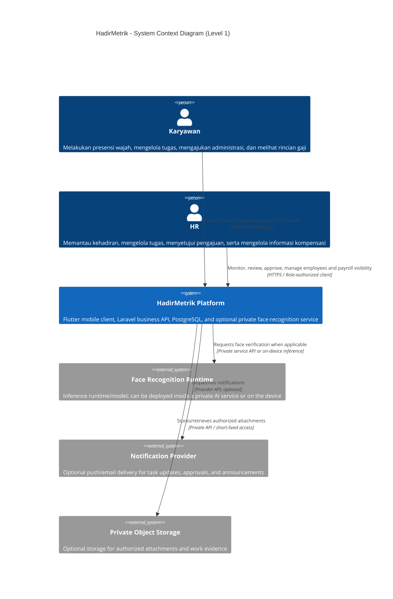
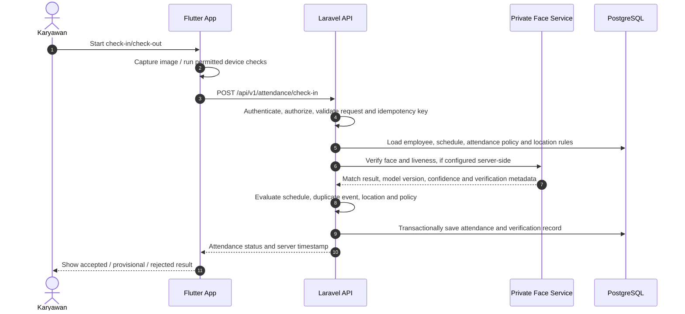
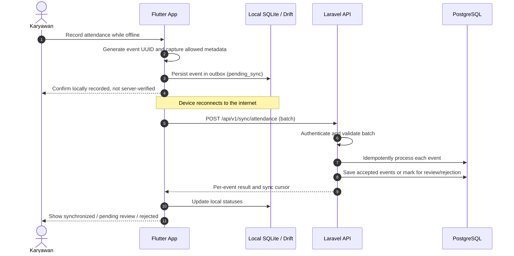
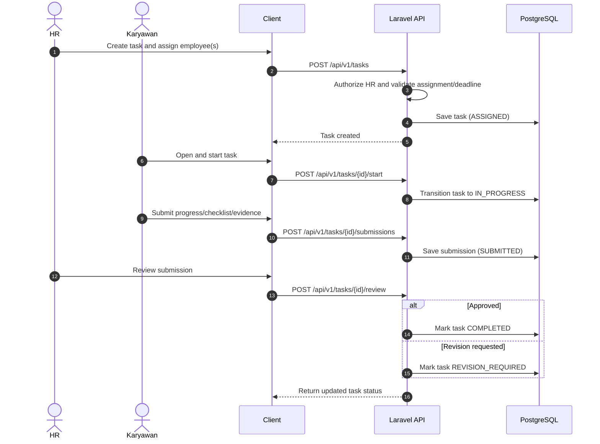
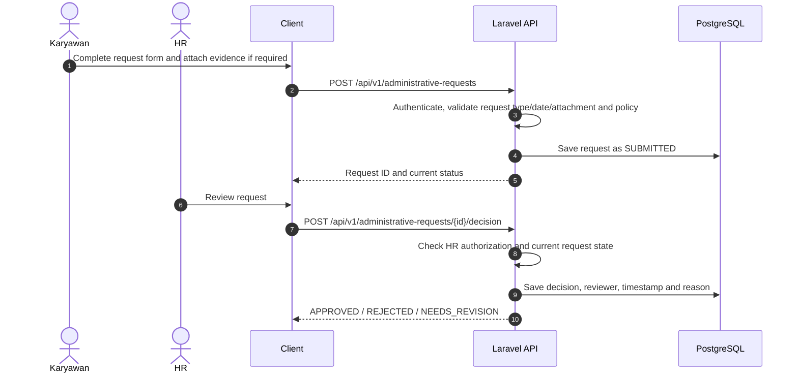
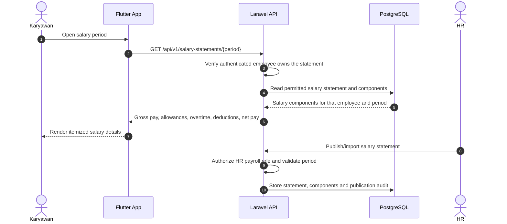
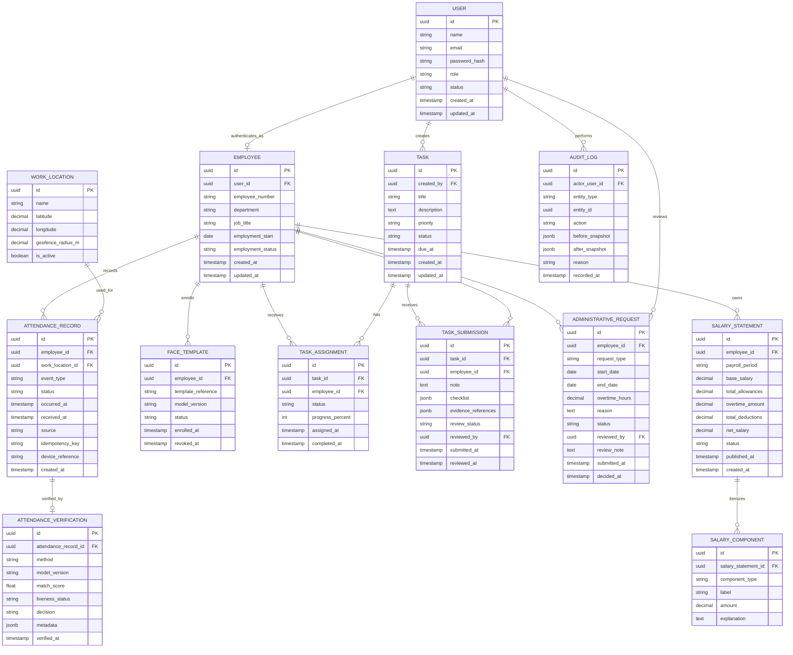
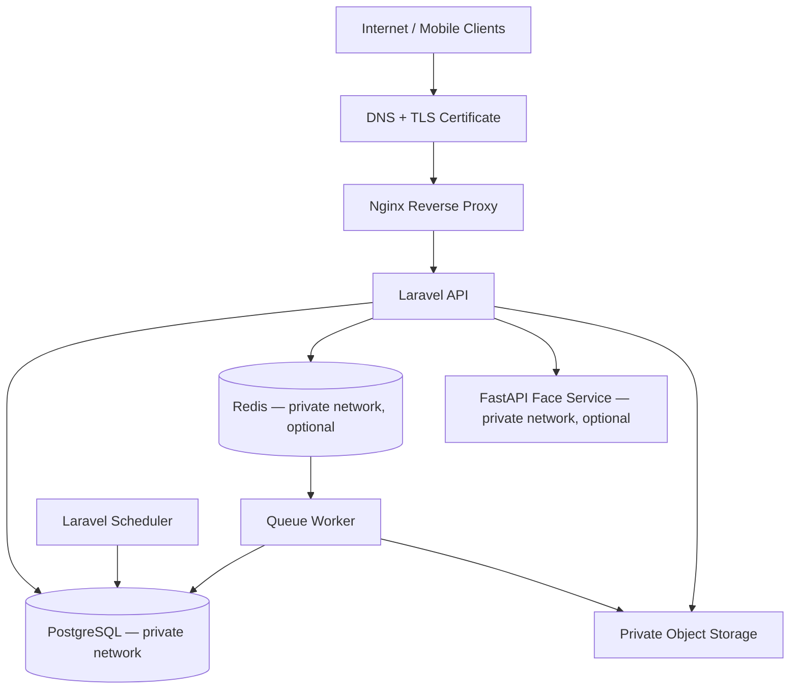

# HadirMetrik — AI Employee Attendance & Workforce Management: System Architecture

**Document Version:** 1.0.0  
**Status:** Proposed Architecture Baseline  
**Target Stack:** Flutter / Dart, Laravel REST API, PostgreSQL, Redis (optional queue/cache), Python FastAPI for face-recognition inference (subject to model and deployment decisions), Docker, Nginx  
**Architecture Style:** Polyrepo + Laravel Modular Monolith  
**Primary Interface:** Mobile application  
**Domain Strategy:** One root domain with a dedicated API subdomain; exact domain to be selected by the project team

---

## 1. Executive Summary & Objective

HadirMetrik is an integrated employee activity and administration platform. It connects face-based attendance, task management, leave/permission/overtime requests, salary transparency, and HR monitoring within a common application ecosystem.

The architecture separates presentation clients from server-side business rules. Flutter provides the employee mobile experience. Laravel is the authoritative backend for identity, permissions, attendance rules, task workflows, administrative requests, compensation visibility, and audit history. A face-recognition service may run as a private Python service if the selected model and deployment approach require it.

The system is designed around the following principles:

- **Backend as Source of Truth:** Authorization, approval decisions, attendance policy, salary access, and final business state are enforced on the server.
- **Modular Monolith First:** Domain boundaries are explicit inside one Laravel application. Microservices are not introduced for ordinary business modules without a demonstrated need.
- **Offline-Tolerant Attendance:** The mobile client may queue eligible attendance events locally and synchronize them later. Offline events remain provisional until server validation completes.
- **Human Approval for Administrative Decisions:** Leave, permission, overtime, task review, and attendance corrections follow explicit workflow states and role checks.
- **Sensitive Data Protection:** Face templates, possible face images, salary records, location information, and employment records receive scoped access, retention policies, and audit logging.
- **Polyrepo with API Contract:** Mobile and backend can be developed independently while integrating through versioned REST endpoints documented using OpenAPI.
- **One Domain Family:** Public clients use HTTPS endpoints under the chosen domain. Internal AI and database services are not exposed directly to the public internet.

This document describes a proposed implementation baseline. Model selection, liveness policy, offline acceptance rules, dashboard platform, payroll source of truth, and production capacity must be confirmed before release.

---

## 2. System Context (C4 Level 1)



### 2.1 Actors and Scope

| Actor | Responsibilities |
|---|---|
| Karyawan | Check-in/check-out, view attendance history, receive and update tasks, submit work evidence, submit leave/permission/overtime requests, view permitted salary details. |
| HR | Monitor attendance and locations, review attendance anomalies, manage employee records, distribute and review tasks, approve administrative requests, manage salary statement availability and access. |
| System administrator (if required) | Manage system-level configuration and roles. This role should be separated from routine HR operations where possible. |

### 2.2 External Systems and Assumptions

- A push-notification provider is optional and not specified as a mandatory dependency.
- Private object storage is recommended if task attachments, request documents, or salary statement PDFs must be retained as files.
- The face-recognition runtime may be on-device, server-side, or hybrid. The final choice depends on accuracy, offline requirements, anti-spoofing needs, device capability, and privacy review.
- The provided application description does not define an external payroll or HRIS integration. Payroll data is therefore treated as backend-managed or imported until the source of truth is decided.

---

## 3. Component Architecture (C4 Level 2)

```mermaid
flowchart TB
    subgraph Clients["Presentation Layer"]
        Mobile["Flutter Mobile App (Dart)"]
        HRUI["HR Dashboard / HR Client (platform to be confirmed)"]
        LocalDB[("Local SQLite / Drift")]
    end

    subgraph Edge["Public Edge"]
        Nginx["Nginx / TLS / Reverse Proxy"]
        API["Laravel REST API (/api/v1)"]
    end

    subgraph Backend["Laravel Modular Monolith"]
        Identity["Identity & Access"]
        Employees["Employee Management"]
        Attendance["Attendance & Location Rules"]
        Tasks["Task Management"]
        Requests["Leave / Permission / Overtime"]
        Payroll["Salary Transparency"]
        FaceAdapter["Face Verification Adapter"]
        Sync["Offline Sync & Idempotency"]
        Reports["HR Dashboard & Reports"]
        Audit["Audit & Activity History"]
    end

    subgraph Infra["Persistence & Background Processing"]
        DB[("PostgreSQL")]
        Redis[("Redis — optional")]
        Worker["Laravel Queue Worker"]
        Scheduler["Laravel Scheduler"]
        Storage["Private Object Storage — optional"]
    end

    AI["Private Python FastAPI AI Service — optional"]
    Notify["Notification Provider — optional"]

    Mobile <--> LocalDB
    Mobile --> Nginx
    HRUI --> Nginx
    Nginx --> API
    API --> Identity
    API --> Employees
    API --> Attendance
    API --> Tasks
    API --> Requests
    API --> Payroll
    API --> FaceAdapter
    API --> Sync
    API --> Reports
    API --> Audit

    Identity <--> DB
    Employees <--> DB
    Attendance <--> DB
    Tasks <--> DB
    Requests <--> DB
    Payroll <--> DB
    Sync <--> DB
    Reports <--> DB
    Audit --> DB

    FaceAdapter --> AI
    API --> Redis
    Redis --> Worker
    Worker --> DB
    Scheduler --> DB
    Tasks --> Storage
    Requests --> Storage
    Payroll --> Storage
    Worker --> Notify
```



### 3.1 Architectural Boundaries

- **Flutter Mobile:** UI, client-side form validation, secure token storage, local cache, offline attendance outbox, and API integration.
- **HR Dashboard / HR Client:** Role-specific administrative views. The platform for this client remains a product decision; it can be a web application or an HR mode in the mobile app. Both should use the same Laravel API.
- **Laravel API:** Owns authorization, validation, business rules, workflow transitions, data persistence, and final decisions.
- **Face Verification Adapter:** A backend boundary that isolates the rest of the application from the selected AI provider, inference protocol, model version, and response format.
- **Python FastAPI AI Service:** Optional isolated inference service. It should be kept on a private network or protected with service-to-service authentication.
- **PostgreSQL:** Primary source of truth for operational records.
- **Redis / Queue Worker:** Optional at the earliest prototype stage; recommended for asynchronous notifications, file processing, and tasks that should not block API responses.
- **Object Storage:** Use private storage for attachments or salary statements if documents are stored as files. Do not expose buckets publicly.

### 3.2 Suggested Repository Layout

Use separate repositories for independent development and deployment:

```text
hadirmetrik-mobile/       # Flutter employee app
hadirmetrik-backend/      # Laravel modular monolith
hadirmetrik-ai-service/   # Python FastAPI; only if separately needed
hadirmetrik-admin/        # HR web dashboard; only if implemented as a separate web client
```

The API contract is the integration boundary between repositories. A shared OpenAPI document can be stored in the backend repository and published or copied to a versioned API-contract location. Repository separation does not mean that the apps cannot share a domain.

### 3.3 Suggested Laravel Domain Modules

```text
app/
├── Modules/
│   ├── Identity/
│   ├── Employees/
│   ├── Attendance/
│   ├── FaceVerification/
│   ├── Tasks/
│   ├── AdministrativeRequests/
│   ├── Payroll/
│   ├── Notifications/
│   ├── Reports/
│   ├── Sync/
│   └── Audit/
├── Http/
│   ├── Controllers/
│   ├── Middleware/
│   └── Requests/
├── Jobs/
├── Policies/
└── Providers/
```

This is a suggested domain organization, not a Laravel framework requirement. Standard Laravel folders can also be retained if service classes, policies, transactions, and module boundaries are consistently enforced. The modules remain part of one Laravel application and one primary database unless future evidence justifies extraction.

### 3.4 Suggested Flutter Feature Layout

```text
lib/
├── core/
│   ├── auth/
│   ├── networking/
│   ├── database/
│   ├── sync/
│   └── security/
├── features/
│   ├── attendance/
│   ├── face_verification/
│   ├── tasks/
│   ├── administrative_requests/
│   ├── salary/
│   └── profile/
└── main.dart
```

---

## 4. End-to-End Sequence Flows

### 4.1 Face Attendance — Online



**Important:** A similarity score alone does not prove liveness or physical presence. The exact checks depend on the evaluated model, liveness approach, camera capture flow, and policy.

### 4.2 Offline Attendance and Synchronization



Offline events are provisional until the server completes validation. Device time, GPS, and local AI output can be manipulated; they must not be treated as conclusive evidence by themselves.

### 4.3 Task Lifecycle



### 4.4 Leave / Permission / Overtime Request



### 4.5 Salary Transparency



Salary values must be protected by object-level authorization. A client must never be able to retrieve another employee's salary simply by changing an ID or period parameter.

---

## 5. Domain State Machines

### 5.1 Attendance Event State

```text
[CAPTURED_LOCAL]
      |
      | queued for synchronization
      v
[PENDING_SYNC] --> [SYNCING]
                      |
          +-----------+------------+
          |           |            |
          v           v            v
      [ACCEPTED] [PENDING_REVIEW] [REJECTED]
          ^           | 
          |           v
          +------[REVIEW_ACCEPTED]
                      |
                      +----------> [REVIEW_REJECTED]

[SYNCING] --transient network/server failure--> [SYNC_FAILED]
[SYNC_FAILED] --retry--> [PENDING_SYNC]
```

Suggested rules:

- `CAPTURED_LOCAL` and `PENDING_SYNC` are local states, not server-accepted attendance states.
- The server decides `ACCEPTED`, `PENDING_REVIEW`, or `REJECTED`.
- Retry must reuse the same `event_id` / idempotency key.
- Review actions must be recorded with actor, timestamp, decision, and reason.
- Do not silently change an accepted record; use correction records and audit history.

### 5.2 Task State

```text
[DRAFT] --> [ASSIGNED] --> [IN_PROGRESS] --> [SUBMITTED]
                 ^                                |
                 |                                v
                 |                         [UNDER_REVIEW]
                 |                           /        \
                 |                      approve      revision
                 |                          |            |
                 |                          v            v
                 +-------------------- [COMPLETED] [REVISION_REQUIRED]
                                                       |
                                                       v
                                                  [IN_PROGRESS]
```

Suggested terminal or exceptional states such as `CANCELLED` may be added when the task policy is defined. State transitions must be checked server-side rather than accepted directly from the client.

### 5.3 Administrative Request State

Applies to cuti, izin, and lembur requests, with request-specific validation rules:

```text
[DRAFT] --> [SUBMITTED] --> [UNDER_REVIEW]
                                |
               +----------------+----------------+
               |                |                |
               v                v                v
          [APPROVED]        [REJECTED]     [NEEDS_REVISION]
                                                   |
                                                   v
                                               [SUBMITTED]
```

The API should prevent decisions from being applied twice and should define whether an approved request can be cancelled or amended.

### 5.4 Salary Statement State

```text
[DRAFT] --> [REVIEWED] --> [PUBLISHED] --> [SUPERSEDED]
   |
   +--------------------> [CANCELLED]
```

This is a proposed workflow. If the system imports finalized payroll from another source, the statement may enter as `REVIEWED` or `PUBLISHED` based on the integration contract.

### 5.5 Permitted Transition Rules

| Entity | Transition | Authorized actor | Server-side guard |
|---|---|---|---|
| Attendance | Pending review → accepted/rejected | HR with attendance-review permission | Event is reviewable; decision and reason are recorded. |
| Task | Draft → assigned | HR/task manager | Actor can assign task and assignees are active employees. |
| Task | Submitted → completed/revision required | Task reviewer | Submission belongs to task; reviewer has permission; decision is not duplicated. |
| Request | Submitted → approved/rejected/needs revision | HR approver | Request is in reviewable state; approval policy is satisfied. |
| Salary statement | Draft/reviewed → published | Payroll-authorized HR | Period and statement are valid; actor has payroll permission. |
| Employee | Any sensitive profile change | Authorized HR/admin | Policy and audit record are required. |

---

## 6. Domain Model & Persistence Schema

### 6.1 Entity-Relationship Diagram (ERD)

The following ERD represents a baseline. Fields and relationships should be adjusted after requirements for payroll calculation, multi-location policy, and task collaboration are finalized.



### 6.2 Additional Tables to Consider

| Table | Purpose |
|---|---|
| `devices` | Device registration and trust metadata if device binding is a requirement. |
| `sync_batches` | Tracks submitted synchronization batches and processing summaries. |
| `attendance_correction_requests` | Formal corrections to attendance records, instead of silently overwriting them. |
| `request_attachments` | Metadata for evidence/document attachments. |
| `task_attachments` | Metadata for work evidence and task files. |
| `notifications` | Optional in-app notifications and delivery status. |
| `salary_publication_events` | Optional separate log for payroll publication actions. |
| `personal_access_tokens` or equivalent | Depends on the selected Laravel authentication approach. |

### 6.3 Persistence and Integrity Rules

- Use UUIDs or another globally unique event identifier for mobile-generated attendance events.
- Add foreign keys, appropriate indexes, and unique constraints.
- Define uniqueness around attendance event idempotency so retries cannot create duplicates.
- Store both client-claimed `occurred_at` and server `received_at`; do not treat the device clock as authoritative.
- Store timestamps consistently (prefer UTC in persistence) and render local time according to the organization's configured timezone.
- Store salary amounts with an exact decimal type, not binary floating-point.
- Do not store raw face images or embeddings unless the use case requires it and access, retention, encryption, and deletion policies are documented.
- Prefer private references to files over public URLs.
- Audit consequential administrative actions, particularly attendance corrections, approvals, employee changes, and salary publication.

---

## 7. API Design & Typed Contracts

All endpoints use a versioned prefix, for example:

```text
https://api.<domain-anda>/api/v1
```

The exact domain must be chosen by the project team. Flutter and any HR dashboard use the same API contract. OpenAPI/Swagger should define request schemas, response schemas, validation errors, authentication requirements, and pagination.

### 7.1 Candidate Endpoint Catalog

> The table below is a candidate catalog, not the final contract. Implemented
> auth endpoints are pinned in `docs/openapi/auth.yaml`: `/api/v1/register`,
> `/api/v1/login`, `/api/v1/me`, and `/api/v1/logout`.

| Method | Endpoint | Purpose |
|---|---|---|
| `POST` | `/auth/login` | Authenticate a user. |
| `POST` | `/auth/logout` | Revoke the current session/token where supported. |
| `GET` | `/me` | Get authenticated user's profile and permissions. |
| `GET` | `/bootstrap` | Get minimum reference data and policy versions for client initialization. |
| `GET` | `/attendance/history` | Read own attendance history; HR access is policy-scoped. |
| `POST` | `/attendance/check-in` | Submit online check-in. |
| `POST` | `/attendance/check-out` | Submit online check-out. |
| `POST` | `/sync/attendance` | Submit offline attendance events in a batch. |
| `GET` | `/sync/changes?cursor=...` | Retrieve server changes after a cursor/version. |
| `GET` | `/hr/attendance/summary` | HR attendance metrics and anomaly summaries. |
| `GET` | `/hr/attendance/map` | Return authorized location events for HR monitoring. |
| `GET` | `/tasks` | List assigned tasks; HR views depend on role. |
| `POST` | `/tasks` | Create a task (HR/task manager). |
| `GET` | `/tasks/{id}` | Get task details if authorized. |
| `POST` | `/tasks/{id}/start` | Mark task in progress. |
| `POST` | `/tasks/{id}/submissions` | Submit progress, checklist, and evidence references. |
| `POST` | `/tasks/{id}/review` | Approve task submission or request revision. |
| `GET` | `/administrative-requests` | List requests visible to the current user. |
| `POST` | `/administrative-requests` | Submit cuti/izin/lembur request. |
| `POST` | `/administrative-requests/{id}/decision` | HR decision, with role and state validation. |
| `GET` | `/salary-statements` | List salary periods for the authenticated employee. |
| `GET` | `/salary-statements/{id}` | Read the caller's salary statement if authorized. |
| `POST` | `/hr/salary-statements/import` | Optional import endpoint; exact workflow to be decided. |
| `POST` | `/hr/salary-statements/{id}/publish` | Publish a salary statement (payroll permission required). |
| `POST` | `/face/enrollments` | Start enrollment/re-enrollment according to policy. |
| `GET` | `/face/template-version` | Return current enrollment/model policy version, if applicable. |
| `POST` | `/attendance-correction-requests` | Request attendance correction. |
| `POST` | `/attendance-correction-requests/{id}/decision` | HR decision on a correction request. |

This endpoint list is a proposed starting point, not an implemented contract. Endpoint naming and request/response schemas should be settled in OpenAPI before parallel frontend/backend work accelerates.

### 7.2 Example: Check-in Request

```http
POST /api/v1/attendance/check-in
Authorization: Bearer <access-token>
Idempotency-Key: 55b3f4fc-267a-4ef8-9c38-8c351cfe7f70
Content-Type: application/json
Accept: application/json
```

```json
{
  "event_id": "55b3f4fc-267a-4ef8-9c38-8c351cfe7f70",
  "occurred_at": "2026-10-19T08:02:11+07:00",
  "device_reference": "registered-device-id",
  "location": {
    "latitude": -7.78,
    "longitude": 110.37,
    "accuracy_m": 20
  },
  "face_verification": {
    "verification_reference": "client-or-server-defined-reference"
  }
}
```

The fields above are illustrative. Location and face-verification fields must be finalized based on the privacy policy and selected AI topology. Client-supplied verification metadata is not trusted merely because it appears in the payload.

### 7.3 Example: Per-event Sync Response

```json
{
  "data": [
    {
      "event_id": "55b3f4fc-267a-4ef8-9c38-8c351cfe7f70",
      "status": "pending_review",
      "server_received_at": "2026-10-19T01:05:02Z",
      "reason_code": "OFFLINE_EVENT_REQUIRES_REVIEW"
    }
  ],
  "next_cursor": "attendance-sync-cursor"
}
```

A batch response should report results per event. One invalid event should not silently hide the status of the other events in the batch.

### 7.4 Example: Salary Statement Response

```json
{
  "data": {
    "id": "salary-statement-id",
    "period": "2026-09",
    "status": "published",
    "currency": "IDR",
    "components": [
      { "type": "base_salary", "label": "Gaji pokok", "amount": "5000000.00" },
      { "type": "allowance", "label": "Tunjangan", "amount": "500000.00" },
      { "type": "overtime", "label": "Lembur", "amount": "250000.00" },
      { "type": "deduction", "label": "Potongan", "amount": "100000.00" }
    ],
    "net_salary": "5650000.00"
  }
}
```

All names and monetary values in this example are fictional and illustrative. The backend must derive or validate the net amount according to the approved payroll data source and rules.

---

## 8. Offline Sync, Idempotency & Runtime Guardrails

### 8.1 Mobile Outbox Pattern

The Flutter client should use SQLite/Drift or another tested local database for attendance events that may need to be synchronized later.

Each queued event should include, as applicable:

- `event_id` (UUID generated once and reused during retries)
- employee/session reference
- event type (`check_in` / `check_out`)
- device-captured time
- locally captured allowed metadata
- local state and retry metadata
- schema/policy version used at capture time

Suggested local states:

```text
CAPTURED_LOCAL
PENDING_SYNC
SYNCING
SYNCED
PENDING_REVIEW
REJECTED
SYNC_FAILED
```

The local status `SYNCED` means the server has returned a result for the event. The server decision may still be `PENDING_REVIEW`; therefore the application should not conflate successful transport with accepted attendance.

### 8.2 Idempotency Rules

- The mobile client generates one immutable `event_id` per attendance action.
- The same ID is reused for every retry of that action.
- The API stores the idempotency key with an appropriate unique constraint.
- If the same event is submitted again, the API returns the recorded result rather than creating another attendance record.
- The API validates employee ownership and rejects replay attempts that reuse an ID with materially different payload data.
- State transitions and persistence should be transactional.

### 8.3 Retry, Timeout and Batch Limits

Initial values below are tuning candidates, not final production commitments:

| Parameter | Initial proposal | Enforcement |
|---|---|---|
| Connect timeout | 10 seconds | HTTP client/API gateway configuration. |
| API response timeout | 20–30 seconds for ordinary requests | Keep long AI/file work out of synchronous requests when possible. |
| Batch size | Start with a modest limit (e.g. 50 events/request) | Validate maximum payload and per-event cost. |
| Retry | Exponential backoff with jitter for transient failures | Do not retry validation/authentication errors blindly. |
| Idempotency | Required for mutating/sync operations that may be retried | Unique key and transactional server-side logic. |
| AI latency | Set a budget after model benchmarking | Timeouts, bounded input, and explicit unavailable/failure states. |
| Background jobs | Redis queue or equivalent if needed | Idempotent jobs, bounded retries, dead-letter/error handling where available. |

### 8.4 Offline Policy Decision

The product owner must decide which of these policies applies:

1. **Provisional acceptance:** show that the event was recorded locally, then let the server accept or reject it after synchronization.
2. **Review required:** all offline events enter an HR review queue.
3. **Restricted offline mode:** offline check-in is allowed only for specific roles, sites, or time windows.

Whichever policy is chosen, the UI must communicate that a locally stored event is not yet verified by the server.

---

## 9. Face Recognition & Verification Architecture

Face recognition is a core application component, but the supplied description does not specify the model, embedding format, liveness technology, threshold, or inference location. Those decisions require evaluation.

### 9.1 Candidate Topologies

| Approach | Benefits | Risks / constraints |
|---|---|---|
| On-device inference | Can support offline user experience and reduce image upload volume. | Model extraction/manipulation, device variation, and client-result trust. |
| Server-side inference | Centralized model versioning, thresholds, and verification rules. | Network dependency, privacy implications of uploading biometric samples, server inference cost. |
| Hybrid | Local feedback plus server-side verification when connected. | More complex state management; local result must not be treated as authoritative evidence. |

### 9.2 Recommended Integration Boundary

Use a Laravel interface/service such as `FaceVerificationProvider` to decouple attendance rules from the selected model and runtime. If inference uses Python, Laravel calls a private FastAPI service through a documented service contract.

Example conceptual response:

```json
{
  "decision": "match",
  "match_score": 0.91,
  "liveness": "verified",
  "model_version": "model-version-id",
  "verification_reference": "verification-id"
}
```

This is only an illustrative shape. The actual model output and decisions must be calibrated and validated; a numeric threshold or a `match` value alone must never be assumed to establish liveness.

### 9.3 Enrollment and Lifecycle

The enrollment process should define:

- Who is permitted to enroll or re-enroll an employee.
- How employee identity is checked before enrollment.
- How capture quality is assessed.
- Which model/version produced each template.
- How templates are revoked or deleted after employment ends or consent/legal basis changes.
- How model changes are evaluated and rolled out.
- How false matches, failed matches, and exceptions are escalated to HR.

### 9.4 Model Evaluation Requirements

Evaluate at minimum:

- False Acceptance Rate (FAR) and False Rejection Rate (FRR).
- Performance across lighting, camera quality, pose, and relevant user groups.
- Liveness / anti-spoofing performance against printed photos, replayed images, and other plausible attacks.
- Enrollment failure rate and quality thresholds.
- Threshold calibration using representative validation data.
- Behavior under offline operation and model/version mismatch.

Do not claim production-grade accuracy until these measures are tested on representative data.

---

## 10. Human Approval, Roles & Workflow Enforcement

HadirMetrik contains several workflows that should not be reduced to arbitrary status updates from the client.

### 10.1 Role and Permission Model

Suggested roles or permission groups:

| Role / permission group | Typical permissions |
|---|---|
| Employee | Access own profile, own attendance, assigned tasks, own requests, and own published salary statements. |
| HR attendance | View authorized attendance overview, review anomalies, decide attendance corrections. |
| HR task manager | Create/assign tasks and review submissions within assigned organizational scope. |
| HR approver | Decide permitted leave/permission/overtime requests. |
| Payroll manager | Import/manage salary statement data and publish statements. |
| System administrator | Manage system-level configuration and roles; should not automatically receive unrestricted payroll access unless required. |

A user may hold multiple permission groups. Exact roles and organizational scopes need product-owner approval.

### 10.2 Approval Gate Rules

For any HR decision endpoint, the backend should enforce:

1. Authentication of the acting user.
2. Authorization for the relevant action and organizational scope.
3. State assertion: the target record is in a decision-eligible state.
4. Idempotency: the same decision cannot be applied more than once.
5. Validation of required reason, dates, hours, or supporting data.
6. Transactional persistence of decision and audit event.
7. A notification or in-app status update if configured.

HR approval should not be inferred from hiding or showing buttons in the UI. The API remains authoritative.

### 10.3 Audit Log Semantics

Audit events should cover important actions such as attendance review/correction, task assignment/review, request decisions, employee account changes, enrollment changes, and salary statement publication.

For the initial architecture, audit logging is **not claimed to be cryptographically tamper-proof**. Recommended controls:

- Append-only behavior for the application database role where practical.
- Store actor ID, action, target entity, server timestamp, reason, and relevant before/after snapshots.
- Restrict direct database access and monitor privileged operations.
- Define retention and access policy for audit logs, since snapshots may contain personal or financial information.

---

## 11. Single-Domain Strategy & Deployment Topology

The mobile and backend repositories can remain separate while production services use a common domain family. The actual domain is not specified yet; examples below use placeholders.

### 11.1 Domain Map

```text
https://<domain-anda>          -> Public information site, if any
https://app.<domain-anda>      -> HR web dashboard, if implemented separately
https://api.<domain-anda>      -> Laravel REST API
```

Flutter does not require its own website domain. It calls `https://api.<domain-anda>/api/v1`.

Python FastAPI, PostgreSQL, Redis, and object storage should not be publicly exposed just to achieve one domain. Keep internal services on the private network, or use service authentication and restrictive network controls where private networking is unavailable.

### 11.2 Example Deployment Diagram



### 11.3 Routing Notes

For a single-VPS deployment:

- Nginx terminates TLS and proxies `api.<domain>` traffic to the Laravel API or serves Laravel through PHP-FPM.
- The API should be versioned and enforce authentication and authorization.
- Database, Redis, and AI service ports should not be exposed to the public internet.
- Configure trusted proxy settings correctly so Laravel recognizes HTTPS and client IP headers.
- If the HR dashboard is a separate web application, route `app.<domain>` to that application; it still calls the same API.
- If no HR web dashboard is required, omit the `app.` subdomain.

### 11.4 Docker Compose Service Candidates

```text
nginx
laravel-app / php-fpm
laravel-queue-worker       # when queue is enabled
laravel-scheduler
postgres
redis                      # optional
face-ai-service            # optional
```

Object storage may be managed externally or deployed privately. The actual VPS sizing must be based on concurrency, biometric inference placement, request volume, and load testing. Any initial CPU/RAM estimate is only a test starting point, not a capacity guarantee.

---

## 12. Security, Privacy & Compliance Controls

HadirMetrik handles face biometrics, attendance times, possible location data, task records, administrative documents, and salary data. These data types require explicit access controls and lifecycle policies.

### 12.1 Application Security Baseline

- HTTPS for all external traffic.
- Secure session/token lifecycle; store mobile tokens in platform secure storage.
- Role- and scope-based authorization on every protected resource.
- Object-level authorization for employee-owned attendance, tasks, requests, and salary statements.
- Request validation, rate limits, upload restrictions, and safe error responses.
- Idempotency and replay controls for attendance/sync endpoints.
- Strong password hashing and appropriate authentication protections.
- Secrets outside source control and restricted production access.
- Database backups, tested restoration, monitoring, and incident-response procedures.
- Dependency updates, CI tests, and security review before production.

### 12.2 Biometric Data

- Decide whether the system needs raw face images, embeddings, or both.
- Minimize the stored biometric data and restrict who can view/export it.
- Encrypt sensitive data at rest where appropriate and enforce TLS in transit.
- Define retention, revocation, and deletion procedures.
- Do not put face images, embeddings, tokens, or sensitive personal details into general-purpose logs.
- Restrict any evidence URL; use private storage and short-lived authorization where appropriate.
- Review the legal basis, notice/consent process where applicable, retention purpose, and employee rights before collection.

### 12.3 Location and HR Monitoring

- Define whether GPS is mandatory, optional, or only a risk signal.
- Define permitted collection times and whether location is collected only at check-in/check-out.
- Show HR only the locations and employee records within their authorized scope.
- Store location precision only to the level needed for policy enforcement.
- Do not describe a location as “real-time” unless the product actually collects and transmits live location. The supplied description mentions real-time monitoring, but the collection interval and technical behavior must be specified.

### 12.4 Salary and Employment Data

- Apply strict object-level authorization for salary statements.
- Separate payroll management permissions from general HR permissions if the organization requires it.
- Record creation, import, correction, and publication history.
- Avoid exposing downloadable salary files through public URLs.
- Define retention and handling for payroll data and request attachments.

### 12.5 Regulatory Review

Before production, review applicable Indonesian personal-data protection requirements, including **UU No. 27 Tahun 2022 tentang Pelindungan Data Pribadi**, and any other employment, payroll, or sector-specific requirements that apply to the organization. This document is an architecture proposal, not legal advice or a statement of completed compliance.

---

## 13. Evaluation & Verification Framework

The release should be gated by automated tests and operational checks. Quantitative acceptance thresholds should be set with the project stakeholders and measured against representative test data.

### 13.1 Business Workflow Tests

1. **Attendance rules:** schedule boundary, duplicate check-in/out, late arrival, missing check-out, location policy, and corrections.
2. **Task workflow:** assignment, progress update, evidence submission, review, revision, completion, and unauthorized transitions.
3. **Administrative requests:** valid/invalid date ranges, leave/permission/overtime rules, approval, rejection, and repeated decision.
4. **Salary transparency:** period listing, decimal arithmetic, publication state, unauthorized cross-employee access, and statement revisions.
5. **RBAC / organization scope:** employee, HR reviewers, approvers, payroll managers, and administrative permissions.

### 13.2 Offline and Integration Tests

- Loss of network during capture, upload, and response.
- App termination/restart while records are pending.
- Duplicate batch submission and partial batch failures.
- Timezone and device-clock manipulation.
- Invalid/expired token on reconnect.
- Model-version or policy-version mismatch.
- AI service unavailable or timing out.
- Database, queue, and object-storage failures.

### 13.3 Face Verification Tests

- FAR and FRR under representative conditions.
- Liveness / anti-spoofing attacks and false liveness acceptance.
- Lighting, device camera, pose, and relevant user-group variation.
- Enrollment quality and re-enrollment.
- Reproducible evaluation using a documented validation dataset.
- Safe fallback behavior when verification is uncertain or unavailable.

### 13.4 Operational Readiness

- Load test around expected morning check-in and end-of-day check-out peaks.
- Monitor API latency/error rate, queue backlog, sync failure rate, AI latency, and disk usage.
- Validate backup restoration and disaster-recovery steps.
- Review audit log retention and privileged access.
- Verify TLS renewal, secret rotation, dependency patching, and deployment rollback.

### 13.5 Proposed Release Gates

Use stakeholder-approved targets rather than unvalidated claims. Candidate release gates include:

- No duplicate attendance records under repeated retry tests.
- No cross-employee exposure of salary data in authorization tests.
- All consequential approval and correction actions generate audit entries.
- The offline sync suite passes app restart, network failure, and partial-batch scenarios.
- Face verification is not released as an authoritative attendance control until model and liveness performance have been evaluated on representative data.
- Restore from backup is successfully tested before production.

---

## 14. Implementation Phases

### Phase 1 — Architecture and Contracts
- Confirm roles, approval rules, attendance policy, payroll source of truth, and dashboard platform.
- Create separate mobile and backend repositories.
- Define API contracts in OpenAPI and agree on error/status semantics.
- Establish Laravel, PostgreSQL, authentication, authorization, CI, and development environments.

### Phase 2 — Core Identity and Attendance
- Implement users/employees, schedules, work locations, attendance events, history, and audit logs.
- Implement server validation, idempotency, and attendance correction workflows.
- Build Flutter attendance UI and API integration.

### Phase 3 — Offline Synchronization
- Add local database/outbox to Flutter.
- Implement batch synchronization, per-event results, retry, idempotency, and review policy.
- Test offline capture with network transitions and app restarts.

### Phase 4 — Face Verification
- Evaluate candidate models and on-device/server/hybrid deployment.
- Implement enrollment lifecycle and verification adapter.
- Benchmark match quality and liveness before making the system production-authoritative.

### Phase 5 — Tasks and Administrative Requests
- Implement task assignment, progress, checklist/evidence, review, and revision.
- Implement cuti/izin/lembur submission, attachments, approval, and status tracking.
- Add optional notifications.

### Phase 6 — Salary Transparency and HR Reporting
- Confirm payroll source of truth and importing/publication workflow.
- Implement salary statement components, employee-scoped visibility, and audit history.
- Implement HR metrics, lateness trends, authorized location views, and approval queues.

### Phase 7 — Hardening and Production
- Complete access-control, biometric-privacy, load, backup/restore, and failure-mode tests.
- Deploy behind HTTPS and restrict internal service exposure.
- Pilot with a limited employee group, collect measured results, and resolve issues before wider rollout.

---

## 15. Decisions Required Before Implementation Is Frozen

The application description identifies the major features and primary users, but the following implementation details remain undefined:

1. **HR client platform:** Flutter-only role-specific UI, separate HR web dashboard, or both?
2. **Face-recognition deployment:** on-device, server-side, or hybrid?
3. **Liveness:** what anti-spoofing method is required, and what evidence supports its performance?
4. **Offline attendance policy:** provisional acceptance, HR review, or restricted offline use?
5. **Location policy:** mandatory GPS, geofence radius, permitted collection times, and accuracy requirements?
6. **Salary source of truth:** manual HR entry, import from payroll software, or a direct integration?
7. **Payroll rules:** Is the application only displaying finalized payroll data, or is it expected to calculate payroll?
8. **Task model:** individual assignment only or group tasks, recurring tasks, comments, and attachments?
9. **Approval hierarchy:** single HR approver, supervisor-first, multiple stages, delegation, and cancellation rules?
10. **Biometric lifecycle:** enrollment authority, retention, re-enrollment, revocation, and deletion process?
11. **Expected scale:** number of employees, peak concurrent attendance, attachment sizes, and data retention period?
12. **Domain and hosting:** selected root domain, VPS/cloud provider, environment topology, and backup policy?

These decisions should be captured as Architecture Decision Records (ADRs) and reflected in the API contract and database migrations.

---

## 16. Architecture Baseline Summary

The proposed baseline for HadirMetrik is:

- **Polyrepo** for Flutter, Laravel, and any independently deployed AI/admin applications.
- **Flutter / Dart** for the mobile employee experience.
- **Laravel modular monolith** as the system of record for attendance, tasks, requests, salaries, permissions, and workflows.
- **PostgreSQL** as the primary database.
- **Redis and Laravel Queue** when asynchronous processing and notifications require them.
- **Python FastAPI** as a private, optional face-recognition service depending on the selected model and topology.
- **Versioned REST API + OpenAPI** as the integration contract between repositories.
- **One domain family**, with `api.<domain-anda>` as the public API endpoint and optional `app.<domain-anda>` for a separate HR dashboard.
- **Offline outbox and idempotent synchronization** for attendance events, with server-side validation.
- **Explicit state machines, role checks, and audit logs** for attendance review, task review, administrative requests, and salary publication.
- **Privacy-by-design** for biometric, location, employment, and financial information.

This is a production-minded starting point, not a claim that all features are already specified or implemented. Finalize the outstanding product decisions, then lock the API contracts, schema, and release acceptance criteria before large-scale parallel development.
