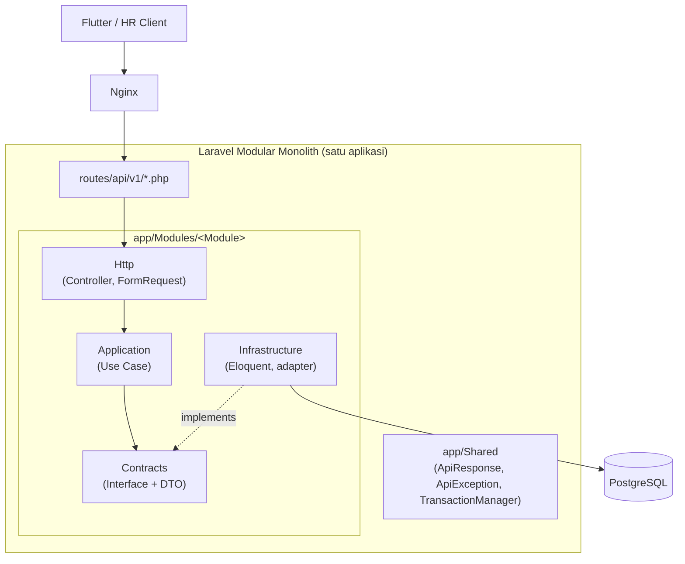
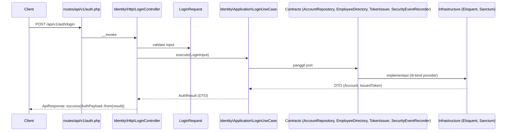

# Panduan Arsitektur Modular Monolith — HadirMetrik Backend

Panduan ini menjelaskan cara kerja arsitektur **Laravel Modular Monolith** di repo `hadirmetrik-backend`: apa itu, kenapa dipilih, bagaimana kode disusun, aturan yang wajib dipatuhi, dan langkah menambah modul baru.

Rujukan utama:

- [`docs/architecture.md`](architecture.md) — §3 (Component Architecture), §10 (Roles & Workflow), §16 (Baseline Summary)
- [`docs/adr/0001-modular-monolith-module-contracts.md`](adr/0001-modular-monolith-module-contracts.md) — keputusan resmi soal struktur modul dan batasnya
- [`tests/Architecture/ModuleBoundaryTest.php`](../tests/Architecture/ModuleBoundaryTest.php) — penegak aturan batas modul

---

## 1. Gambaran Besar

HadirMetrik memakai **polyrepo**: aplikasi Flutter, backend Laravel, layanan AI (FastAPI, opsional), dan dashboard HR (opsional) berada di repo terpisah. Integrasi antar-repo hanya lewat **REST API berversi (`/api/v1`) + OpenAPI** (`docs/openapi/`).

Di dalam repo backend ini, Laravel berjalan sebagai **satu aplikasi, satu proses deploy, satu database PostgreSQL**, tetapi kodenya dibagi menjadi **modul domain** yang batasnya tegas. Itulah "modular monolith":

| | Monolith biasa | **Modular monolith (HadirMetrik)** | Microservices |
|---|---|---|---|
| Deploy | 1 unit | 1 unit | Banyak unit |
| Database | 1 | 1 (tabel dimiliki modul tertentu) | 1 per service |
| Batas kode | Longgar, saling import bebas | Tegas, hanya lewat `Contracts` | Batas jaringan |
| Komunikasi antar-bagian | Panggilan langsung apa saja | Panggilan in-process via interface + DTO | HTTP/gRPC/queue |
| Biaya operasional | Rendah | Rendah | Tinggi |

Tujuannya: mendapatkan kesederhanaan operasional monolith, sambil menjaga batas domain cukup bersih sehingga modul bisa diekstrak menjadi service terpisah **jika suatu hari ada bukti kebutuhan** (architecture.md §3.3).



---

## 2. Daftar Modul

### 2.1 Modul yang sudah ada (Phase 1)

| Modul | Tanggung jawab |
|---|---|
| `Identity` | Akun (`users`), password, token Sanctum, use case login/logout/me |
| `Employees` | Profil karyawan, divisi, shift, lokasi kerja, kompensasi, undangan & pengiriman, use case create employee oleh HR |
| `Audit` | Pencatatan `audit_logs` (aksi consequential) dan `security_events` (telemetri autentikasi) — lihat ADR 0008 |

`app/Shared` **bukan modul**. Isinya hanya hal lintas-modul yang benar-benar generik: envelope respons (`ApiResponse`), basis exception domain (`ApiException`), dan port `TransactionManager`.

### 2.2 Modul target (dari architecture.md §3.3)

```text
app/Modules/
├── Identity/                 ✅ ada
├── Employees/                ✅ ada
├── Audit/                    ✅ ada
├── Attendance/               ⏳ presensi, geofence, koreksi (ADR 0009, 0010)
├── FaceVerification/         ⏳ adapter ke layanan AI (§9)
├── Sync/                     ⏳ batch offline & idempotensi (§8)
├── Tasks/                    ⏳ tugas per-assignment (ADR 0011)
├── AdministrativeRequests/   ⏳ cuti, izin, lembur
├── Payroll/                  ⏳ periode & slip gaji beku (ADR 0006, 0012)
├── Notifications/            ⏳ inbox in-app (ADR 0014)
└── Reports/                  ⏳ dashboard & laporan HR
```

---

## 3. Anatomi Satu Modul

Setiap modul mengikuti empat lapisan (ADR 0001 butir 1) plus satu service provider:

```text
app/Modules/Identity/
├── IdentityServiceProvider.php     # binding Contract → implementasi
├── Contracts/                      # SATU-SATUNYA permukaan publik modul
│   ├── AccountRepository.php       #   interface (port)
│   ├── PasswordHasher.php
│   ├── TokenIssuer.php
│   └── Data/                       #   DTO readonly yang boleh menyeberang modul
│       ├── Account.php
│       ├── AccountCredentials.php
│       ├── AuthResult.php
│       └── IssuedToken.php
├── Application/                    # use case + exception aplikasi (privat)
│   ├── Login/LoginUseCase.php
│   ├── Login/LoginInput.php
│   ├── Logout/LogoutUseCase.php
│   ├── GetAuthenticatedUser/...
│   └── Exceptions/InvalidCredentials.php
├── Infrastructure/                 # detail framework (privat)
│   ├── Models/User.php             #   Eloquent model
│   └── Services/                   #   implementasi Contracts
│       ├── EloquentAccountRepository.php
│       ├── LaravelPasswordHasher.php
│       └── SanctumTokenIssuer.php
└── Http/                           # delivery layer (privat)
    ├── Controllers/LoginController.php
    ├── Requests/LoginRequest.php
    └── AuthPayload.php             #   pembentuk payload respons
```

### Peran tiap lapisan

| Lapisan | Isi | Boleh bergantung pada |
|---|---|---|
| **Contracts** | Interface (port) dan DTO `final readonly` di `Contracts/Data` | Contracts modul lain, `app/Shared` |
| **Application** | Use case (satu kelas = satu aksi bisnis), input object, exception bisnis | Contracts (milik sendiri & modul lain), `app/Shared`, Infrastructure **modul sendiri** |
| **Infrastructure** | Eloquent model, implementasi port (Sanctum, Hash, DB), adapter ke modul lain | Contracts (milik sendiri & modul lain), framework Laravel |
| **Http** | Controller invokable/resource, FormRequest validasi, payload/presenter | Application & Contracts modul sendiri, `app/Shared/Http` |

> Catatan pragmatis: beberapa use case saat ini (mis. `CreateEmployeeUseCase`) masih memakai Eloquent model milik modulnya sendiri secara langsung. Ini diizinkan karena tetap **di dalam** modul yang sama — yang dilarang adalah menyentuh model modul **lain**.

---

## 4. Aturan Batas Modul (Wajib)

Ringkasan ADR 0001:

1. **Lintas modul hanya lewat `Contracts`.** Modul A tidak boleh `use App\Modules\B\Application\...`, `...\Infrastructure\...`, atau `...\Http\...`.
2. **Data lintas modul berupa DTO readonly**, bukan Eloquent model. Jangan pernah mengembalikan `User` atau `Employee` ke modul lain.
3. **Service provider hanya mendaftarkan binding** (dan nantinya policy). Provider **tidak** memuat route atau migration.
4. **Provider didaftarkan eksplisit** di [`bootstrap/providers.php`](../bootstrap/providers.php) — Laravel 13 tidak auto-discover provider aplikasi.
5. **Route terpusat** di `routes/api/v1/*.php`; **migration terpusat** di `database/migrations/`. Modul memiliki model dan logikanya, bukan entrypoint HTTP atau runner skema.
6. **Dependensi framework disembunyikan di balik port.** Sanctum, hashing, dan transaksi DB diakses lewat interface (`TokenIssuer`, `PasswordHasher`, `TransactionManager`), implementasinya di `Infrastructure/Services`.

### Penegakan otomatis

[`tests/Architecture/ModuleBoundaryTest.php`](../tests/Architecture/ModuleBoundaryTest.php) memindai semua file di `app/Modules`, membaca `namespace` dan setiap baris `use App\Modules\...`. Jika suatu file mengimpor modul lain selain `...\Contracts\...`, test gagal dengan pesan seperti:

```text
app/Modules/Identity/... imports App\Modules\Employees\Infrastructure\Models\Employee
(only App\Modules\Employees\Contracts may cross a module boundary)
```

Jalankan dengan `make test` atau `php artisan test`. Test ini sengaja tanpa paket tambahan (cukup PHPUnit).

Keterbatasan yang perlu disadari: test hanya memeriksa pernyataan `use`. Referensi *fully-qualified* di badan kode (`\App\Modules\X\Infrastructure\...`) tidak terdeteksi — jangan lakukan itu.

---

## 5. Pola Komunikasi Antar-Modul

### 5.1 Memanggil kemampuan modul lain

Contoh nyata: `Identity\Application\Login\LoginUseCase` butuh mencari email karyawan dari nomor karyawan dan mencatat security event. Ia meminta interface milik modul lain lewat constructor injection:

```php
use App\Modules\Audit\Contracts\SecurityEventRecorder;   // ✅ Contracts modul Audit
use App\Modules\Employees\Contracts\EmployeeDirectory;   // ✅ Contracts modul Employees

final class LoginUseCase
{
    public function __construct(
        private readonly AccountRepository $accounts,
        private readonly EmployeeDirectory $employees,
        private readonly PasswordHasher $hasher,
        private readonly TokenIssuer $tokens,
        private readonly SecurityEventRecorder $events,
    ) {}
}
```

Container Laravel menyelesaikan interface itu ke implementasi yang di-bind oleh provider modul pemiliknya (`EmployeesServiceProvider`, `AuditServiceProvider`).

### 5.2 Port milik konsumen + adapter (anti-corruption layer)

Jika sebuah modul butuh sesuatu dari modul lain tetapi ingin bentuk data yang sesuai kebutuhannya sendiri, ia mendefinisikan **port di Contracts-nya sendiri**, lalu membuat **adapter di Infrastructure-nya** yang memanggil Contracts modul lain.

Contoh: `Employees` perlu membuat akun login saat HR mendaftarkan karyawan.

```text
Employees\Contracts\UserAccountProvisioner          (port, milik Employees)
        ▲ implements
Employees\Infrastructure\Services\IdentityUserAccountProvisioner
        │ memakai
        ▼
Identity\Contracts\AccountRepository + PasswordHasher (Contracts milik Identity)
```

Adapter mengubah DTO `Identity\Contracts\Data\Account` menjadi DTO milik Employees (`UserAccountData`). Dengan begitu, perubahan internal di Identity tidak merembet ke use case Employees.

### 5.3 Transaksi lintas modul

Karena semua modul berbagi satu database, satu use case boleh menjalankan operasi beberapa modul dalam **satu transaksi** melalui `App\Shared\Contracts\TransactionManager`:

```php
$this->transaction->run(function () use (...) {
    // provisioning akun (Identity via adapter), insert employee, assignment,
    // undangan, dan audit log — atomik.
});
```

Ini salah satu keuntungan modular monolith dibanding microservices: konsistensi kuat tanpa saga/outbox antar-service.

---

## 6. Alur Request dari Ujung ke Ujung

Contoh `POST /api/v1/auth/login`:



Langkah-langkahnya:

1. **Route** (`routes/api.php` → `routes/api/v1/*.php`) memetakan URL ke controller milik modul. Semua di bawah prefix `v1` dan `throttle:api`.
2. **FormRequest** memvalidasi bentuk input.
3. **Controller** tipis: membangun input object, memanggil use case, membungkus hasil dengan `ApiResponse`.
4. **Use case** menjalankan aturan bisnis hanya lewat port.
5. **Kegagalan bisnis** dilempar sebagai subclass `ApiException` (mis. `InvalidCredentials` → 401). Handler di [`bootstrap/app.php`](../bootstrap/app.php) mengubahnya otomatis menjadi envelope error, sehingga controller tidak perlu `try/catch`.

Envelope respons standar (`App\Shared\Http\ApiResponse`):

```json
{ "success": true,  "data": { ... }, "message": "Login berhasil." }
{ "success": false, "message": "Kredensial tidak valid.", "errors": { ... } }
```

---

## 7. Kepemilikan Data

Satu database bukan berarti semua modul bebas menulis ke semua tabel. Setiap tabel punya **modul pemilik**, yaitu modul tempat Eloquent model-nya berada:

| Tabel | Pemilik |
|---|---|
| `users` | Identity |
| `employees`, `divisions`, `shifts`, `work_locations`, `employee_*_assignments`, `employee_compensations`, `employee_invitations`, `invitation_deliveries` | Employees |
| `audit_logs`, `security_events` | Audit |
| `attendance_records`, `attendance_verifications`, `attendance_correction_requests` | Attendance (target) |
| `devices`, `sync_batches` | Sync / Attendance (target) |
| `tasks`, `task_*` | Tasks (target) |
| `administrative_requests`, `request_*` | AdministrativeRequests (target) |
| `payroll_periods`, `salary_*` | Payroll (target) |
| `notifications` | Notifications (target) |

Aturannya:

- Hanya modul pemilik yang membaca/menulis tabelnya lewat Eloquent.
- Modul lain meminta data lewat interface di `Contracts` pemilik dan menerima DTO.
- Foreign key antar-tabel milik modul berbeda **boleh** di level database (integritas data tetap dijaga PostgreSQL), tetapi relasi Eloquent lintas modul sebaiknya dihindari.
- Migration tetap di `database/migrations/` (terpusat), tetapi isinya mengikuti spesifikasi tabel di architecture.md §6.4 dan §6.4.1.

---

## 8. Menambah Modul Baru — Checklist

Contoh: membuat modul `Attendance`.

1. **Buat struktur folder**
   ```text
   app/Modules/Attendance/
   ├── AttendanceServiceProvider.php
   ├── Contracts/
   │   └── Data/
   ├── Application/
   │   └── Exceptions/
   ├── Infrastructure/
   │   ├── Models/
   │   └── Services/
   └── Http/
       ├── Controllers/
       └── Requests/
   ```
2. **Definisikan Contracts dulu**: interface yang akan dipakai modul lain (mis. `AttendanceQuery`) dan DTO readonly di `Contracts/Data`.
3. **Tulis use case** di `Application/<NamaAksi>/<NamaAksi>UseCase.php`, dengan dependensi berupa interface. Exception bisnis turunan `App\Shared\Exceptions\ApiException` di `Application/Exceptions`.
4. **Implementasi Infrastructure**: Eloquent model di `Infrastructure/Models`, implementasi port di `Infrastructure/Services`.
5. **Butuh modul lain?** Inject interface dari `App\Modules\<Lain>\Contracts\...`, atau buat port sendiri + adapter (pola §5.2).
6. **Service provider**: bind setiap interface ke implementasinya di `register()`.
   ```php
   final class AttendanceServiceProvider extends ServiceProvider
   {
       public function register(): void
       {
           $this->app->bind(AttendanceQuery::class, EloquentAttendanceQuery::class);
       }
   }
   ```
7. **Daftarkan provider** di `bootstrap/providers.php`.
8. **Migration** di `database/migrations/` sesuai architecture.md §6.4.1 / §9.6.
9. **Route** di file yang relevan di `routes/api/v1/` (`app.php` untuk karyawan, `admin.php` untuk HR, dst.), menunjuk controller modul.
10. **Kontrak API**: perbarui `docs/openapi/` bila ada endpoint baru atau perubahan bentuk request/response.
11. **Test**: feature test di `tests/Feature/Api/V1/<Area>/`, dan pastikan `ModuleBoundaryTest` tetap hijau.
12. **Keputusan arsitektural baru** → tulis ADR di `docs/adr/`.

---

## 9. Kesalahan Umum dan Cara Benarnya

| ❌ Salah | ✅ Benar |
|---|---|
| `use App\Modules\Employees\Infrastructure\Models\Employee;` di modul Identity | Inject `App\Modules\Employees\Contracts\EmployeeDirectory` dan pakai DTO `EmployeeSummary` |
| Use case mengembalikan Eloquent model ke controller/modul lain | Kembalikan DTO `final readonly` dari `Contracts/Data` |
| Memanggil `Hash::make()` / `$user->createToken()` langsung di use case | Lewat port `PasswordHasher` / `TokenIssuer` |
| `DB::transaction()` di use case | `TransactionManager::run()` |
| `loadRoutesFrom()` / `loadMigrationsFrom()` di service provider modul | Route di `routes/api/v1/`, migration di `database/migrations/` |
| Controller berisi aturan bisnis dan `try/catch` untuk mapping error | Controller tipis; aturan bisnis di use case; error lewat `ApiException` |
| Membaca `role` dari payload client | Role selalu ditetapkan backend (architecture.md §10.1) |
| Menaruh helper domain di `app/Shared` agar "bisa dipakai semua" | `Shared` hanya untuk hal generik lintas-domain; logika domain tetap di modulnya |

---

## 10. Trade-off yang Diterima

Dari ADR 0001:

- **(+)** Batas modul eksplisit dan diperiksa mesin.
- **(+)** Mengganti Sanctum/hasher cukup mengganti adapter.
- **(+)** Use case mudah di-unit-test dengan fake karena hanya bergantung pada interface.
- **(+)** Modul berikutnya (Attendance, Payroll, dst.) punya pola untuk ditiru.
- **(−)** Lebih banyak file dan indirection dibanding Laravel biasa.
- **(−)** Route dan migration terpusat membuat modul tidak sepenuhnya mandiri — diterima demi kesederhanaan operasional.

---

## 11. Bacaan Lanjutan

| Topik | Rujukan |
|---|---|
| Diagram komponen & batas sistem | architecture.md §2, §3 |
| Alur end-to-end (presensi, sync, tugas, gaji, onboarding) | architecture.md §4 |
| State machine domain | architecture.md §5 |
| Skema & spesifikasi tabel | architecture.md §6 |
| Katalog endpoint & error code | architecture.md §7, `docs/openapi/` |
| Offline sync & idempotensi | architecture.md §8, ADR 0009 |
| Adapter face recognition | architecture.md §9 |
| Role, approval gate, audit | architecture.md §10, ADR 0008 |
| Keputusan per domain | `docs/adr/0002` … `0014` |
| Fase implementasi | architecture.md §14, `docs/roadmap.md` |
